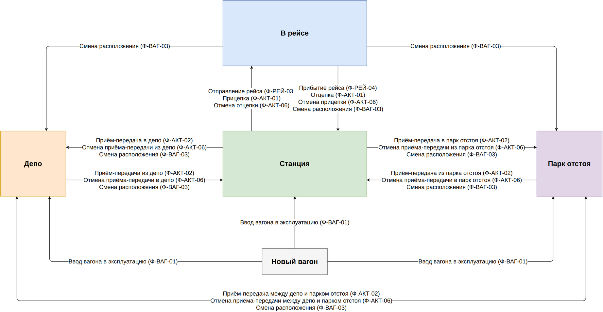
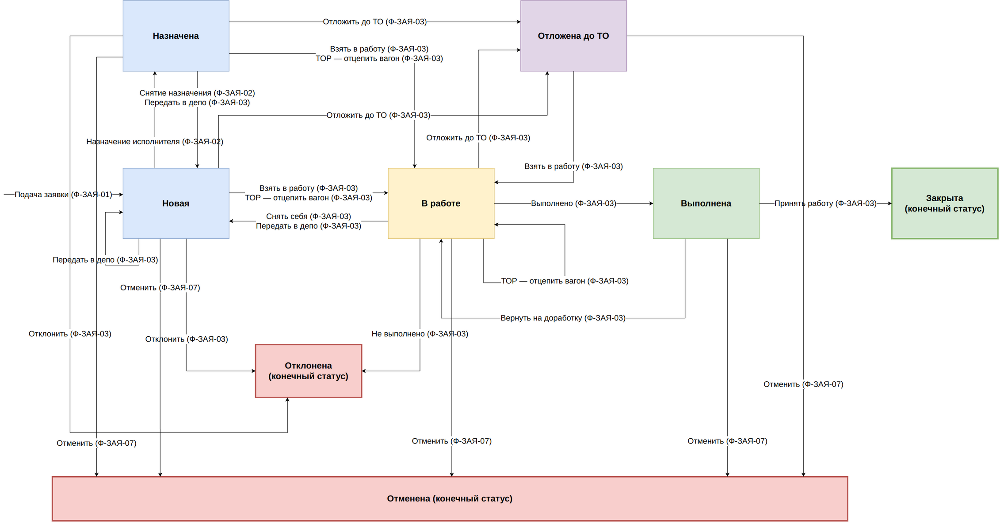

# zhsr: техническое задание - функции

- Функция, которая меняет расположение или состояние вагона, закрывает текущую запись журнала и открывает новую.
- Роль пользователя определяется: в рейсе - по бригаде рейса (`trip_crew`), если рейса в статусе "выполняется" нет -
  по роли в системе (`usr_role`).
- Каждый пользователь привязан к какому-то месту (`usr_depot`); службы пользователя - службы его ролей
  (`role_type.service`); у части ролей службы нет.

## 0. Общее поведение интерфейса

- **Списки:**
    - прокрутка - внутри таблицы, а не всей страницы; заголовок таблицы закреплён;
    - фильтры-переключатели допускают выбор нескольких значений; ничего не выбрано - фильтр не действует; повторный
      клик снимает значение;
    - поля ввода и комбобоксы имеют бледный крестик очистки; элемента "Все..." в списках нет;
    - предустановленный фильтр показан отдельным чипом; снимается крестиком на чипе;
    - выбор периода - переключатель предустановок (Сегодня, 3 дня, Неделя, Месяц) и произвольный интервал "с ...
      по ...";
- **Правая панель записи:**
    - клик по строке списка открывает справа панель со статической информацией записи и кнопками функций;
    - при ширине экрана от 1200px панель закреплена; при открытии раздела выбрана первая строка; при ширине меньше
      1200px панель плавающая той же ширины и открывается только по клику;
    - у плавающей панели повторный клик по выбранной строке снимает выделение; у закреплённой - не снимает;
    - Esc и крестик закрывают панель и снимают выделение;
    - при переходе в функцию записи (формирование рейса, журнал вагона, отцепка и прицепка) панель остаётся на месте
      и не закрывается; при возврате выделение строки сохраняется;
    - кнопка "Редактировать" - под атрибутами записи, до первого разделителя, прижата вправо;
- **Экраны функций** (формирование рейса, журнал вагона, отцепка и прицепка, редактор маршрута, новая заявка): левое
  меню скрыто; слева вверху - кнопка "назад" в квадрате и заголовок экрана;
- **Левое меню:** при ширине экрана от 1400px раскрыто, иначе - узкая панель из иконок; клик по пустому месту меню
  переключает вид; счётчики у пунктов - число записей, требующих внимания: у "Заявок" - заявки, которые ждут действия
  лично пользователя (столько же, сколько в списке "мне на исполнение", Ф-ЗАЯ-06), у "Передачи" -
  акты в статусе "ожидает приёма", которые пользователь может принять (Ф-АКТ-02);
- **Права:** кнопки показываются всегда; кнопка недоступного действия неактивна, и в интерфейсе видно почему;
- **Диалоги и выпадающие списки** закрываются по Esc и кликом мимо;
- **Уведомления:** всплывающих сообщений нет; результат действия виден в списке, панели и журнале.

## 1. Вагоны (ВАГ)

### Ввод вагона в эксплуатацию (Ф-ВАГ-01)

- **Кто:** администратор.
- **Действия:** пользователь вводит номер, тип, модель, год постройки, дату ввода в эксплуатацию, депо приписки и
  паспортные данные вагона и задаёт начальные расположение и состояние вагона. Система создаёт вагон и открывает
  первые записи журналов расположения и состояния.
- **Правила:**
    - номер вагона состоит из 5-8 цифр и не повторяется;
    - начальное расположение - станция, депо или парк отстоя;

### Редактирование вагона (Ф-ВАГ-06)

- **Кто:** администратор.
- **Действия:** пользователь исправляет атрибуты вагона - те же, что при вводе (Ф-ВАГ-01), или указывает дату вывода
  из эксплуатации.
- **Правила:**
    - атрибуты исправляются, только если вагон ни разу не входил в состав рейса и в акты; иначе указывается только
      дата вывода из эксплуатации;
    - дата вывода из эксплуатации - не больше текущей;
    - при указании даты вывода Система переводит вагон в состояние "отставлен" (парк "исключён").

### Смена состояния (Ф-ВАГ-02)

- **Кто:** администратор, планировщик вагонов.
- **Действия:** пользователь выбирает новое состояние вагона и пишет комментарий. Система закрывает текущую запись
  состояния и открывает новую.
- **Правила:** без комментария состояние не меняется; расположение вагона при смене состояния не меняется.

### Смена расположения (Ф-ВАГ-03)

- **Кто:** администратор, планировщик вагонов.
- **Действия:** пользователь выбирает новое расположение вагона и пишет комментарий. Система закрывает текущую запись
  расположения и открывает новую.
- **Правила:**
    - новое расположение - станция, депо или парк отстоя;
    - без комментария расположение не меняется; состояние вагона при смене расположения не меняется.

### Чтение списка вагонов (Ф-ВАГ-04)

- **Кто:** все.
- **Действия:** пользователь указывает фильтр: станция (выбор из списка station), состояние вагона (wagon_status_type),
  расположение (location_type), рейс (trip). Система показывает список вагонов: все атрибуты вагона, а также
  текущее расположение (станция, депо, парк отстоя, рейс) и состояние вагона. При выборе рейса выпадает список, где
  указаны рейсы в статусе "выполняется", с атрибутами их маршрута.
- **Правила:**
    - предустановленные фильтры зависят от роли и от ситуации:
        - пользователь в бригаде рейса (`ЛНП`, `ПЭМ`, проводник) - фильтр установлен в рейс пользователя;
        - рейс пользователя - рейс в статусе "выполняется", в бригаде которого он состоит, а если такого нет -
          ближайший по `planned_dt` рейс в статусе "план", в бригаде которого он состоит (как в Ф-ЗАЯ-01);
        - для роли `мастер депо` станция установлена в ту, за которой он закреплён.
    - поиск по номеру вагона - отменяет все фильтры, в том числе предустановленные по роли: поиск идёт только по
      номеру среди всех вагонов. Фильтры становятся неактивными, но не очищаются.

- **Поведение интерфейса:**
    - при вводе номера фильтры скрываются, вместо них надпись "При поиске по номеру фильтры не применяются.";
    - расположение показывается как "Название • вид расположения"; для вагона в рейсе - "Рейс N от дд.мм" без вида;
    - расположение и состояние показываются с датой начала и длительностью: "с 25.10 01:05, 8 час 25 мин"; от 10
      дней длительность - без часов;
    - панель вагона: расположение и состояние с датой и длительностью; акт приёма-передачи, ожидающий приёма, и куда
      передаётся вагон; паспорт; блок "Рейсы" - рейс в статусе "выполняется" и ближайший рейс в статусе "план", в
      составе которых вагон, ссылкой на формирование рейса; ссылки "Рейсы вагона (N)" (Ф-РЕЙ-00) и "Заявки вагона
      (N)" (Ф-ЗАЯ-06) - переход в список с фильтром по вагону, N - сколько строк будет в списке;
    - действия с вагоном - в меню строки списка: "Журнал вагона", "Передать на станцию", "Передать в депо", "Передать
      в парк отстоя" (Ф-АКТ-02); двойной клик по вагону - журнал вагона.

### Чтение журнала вагона (Ф-ВАГ-05)

- **Кто:** все.
- **Действия:** пользователь выбирает вагон и период. Система показывает всю историю изменений за выбранный период:
  откуда и куда вагон переместился (расположение), когда и на каком основании, как менялось состояние. Выделена строка
  на выбранный момент времени.
- **Правила:** основание - документ, который открыл запись журнала; запись без основания открыта вводом вагона или
  ручной правкой.

- **Поведение интерфейса:**
    - период - как в списке рейсов, с предустановками "текущий месяц", "прошлый месяц";
    - фильтры по расположению и состоянию; колонки и фильтры идут в порядке: расположение, затем состояние.

## 2. Маршруты (МАР)

### Создание маршрута (Ф-МАР-01)

- **Кто:** администратор; планировщик вагонов.
- **Действия:** пользователь создаёт новый маршрут, попадает в окно редактированя. Указывает номер поезда, сообщение,
  дату начала действия маршрута, признак "разовый", время в пути и нормы часов для членов бригады (проводник, ЛНП,
  ПЭМ). Вводит остановки по порядку. Система сохраняет маршрут; изменения сразу доступны при создании и просмотре
  рейсов.
- **Правила:**
    - маршрутная сеть задаётся справочниками станций (`station`), перегонов (`stage`) и депо (`depot`);
    - маршрут - последовательность остановок;
    - узловая станция - станция, на которой есть депо; начальная и конечная станции маршрута - только узловые;
    - начальная станция выбирается из узловых; каждая следующая остановка - любая станция, достижимая по маршрутной сети
      от предыдущей остановки;
    - при выборе станции путь от предыдущей остановки прокладывается по кратчайшему пути; станции следования не
      становятся остановками;
    - система не добавляет остановки сама - ни при выборе дальней станции, ни при удалении остановки;
    - остановку можно вставить после любой станции маршрута; можно удалить любую остановку;
    - при удалении промежуточной остановки путь маршрута не меняется: удалённая остановка показывается как станция
      следования между соседними остановками; общий километраж сохраняется;
    - при вставке остановки или смене станции путь перестраивается только на затронутых перегонах; последующие
      остановки сохраняются;
    - одна и та же станция может идти подряд, только если между ними есть станции следования (например, `Кокшетау ->
      Петропавловск -> Кокшетау` без остановки в Петропавловске);
    - километраж считается автоматически, нарастающим итогом по сохранённому пути между остановками; вручную не
      вводится;
    - порядок остановок вручную не меняется - только вставкой и удалением;
    - сохранение запрещено, если: не указан номер поезда; меньше двух остановок; начальная или конечная станция не
      узловая; одна станция дважды подряд без станций следования между ними; не указано время в пути;
    - если сообщение не указано, оно формируется автоматически из названий остановок через тире.
- **Поведение интерфейса:**
    - между соседними остановками виден путь по маршрутной сети - показаны все существующие станции следования (поезд
      проходит их без остановки);
    - в списке выбора станции упорядочены сначала по числу перегонов от предыдущей остановки (ближайшие соседи, затем
      через одну и т.д.), внутри - по расстоянию; у каждой станции показано расстояние от предыдущей остановки (`+N км`)
    - и станции следования ("через ..."); узловые выделены жирным и помечены "узловая";
    - над формой показана схема маршрута: остановки - синие кружки и жирный текст, станции следования - серые кружки
      и серый текст; в сокращённом виде между остановками показано число станций следования (`-> N ->`); переключение
      полного и сокращённого вида - кликом по схеме;

### Редактирование маршрута (Ф-МАР-02)

- **Кто:** администратор; планировщик вагонов.
- **Действия:** пользователь открывает существующий маршрут на редактирование, далее как в Создание маршрута (Ф-МАР-01):
  вводятся те же атрибуты; либо указывает дату окончания действия маршрута.
- **Правила:**
    - атрибуты исправляются, только если по маршруту нет ни одного рейса; иначе указывается только дата окончания
      действия;
    - дата окончания действия - не больше текущей.

- **Поведение интерфейса (список маршрутов):**
    - фильтры: вид (регулярный, разовый), состояние (действующие, закрытые); по умолчанию - действующие;
    - закрытые маршруты показаны бледнее, с периодом действия;
    - одинарный клик - панель маршрута (схема остановок, атрибуты, нормы часов, "Редактировать"); двойной клик -
      редактор маршрута.

## 3. Рейсы (РЕЙ)

### Чтение списка рейсов (Ф-РЕЙ-00)

- **Кто:** все.
- **Действия:** пользователь указывает фильтр: маршрут (route), станция следования (выбор из списка station),
  номер вагона, состояние рейса, интервал времени. Система показывает список рейсов, для выбранных маршрутов, в
  указанном периоде, проходящих через выбранную станцию, с вагоном в составе.
- **Правила:**
    - предустановленные фильтры зависят от роли и от ситуации:
        - пользователь в бригаде рейса (`ЛНП`, `ПЭМ`, проводник) - фильтр установлен в маршрут рейса пользователя;
        - рейс пользователя - рейс в статусе "выполняется", в бригаде которого он состоит, а если такого нет -
          ближайший по `planned_dt` рейс в статусе "план", в бригаде которого он состоит (как в Ф-ЗАЯ-01);
        - для роли `мастер депо` станция установлена в ту, за которой он закреплён.

- **Поведение интерфейса:**
    - по умолчанию выбраны состояния "план" и "выполняется" и период "следующая неделя";
    - период связан с состояниями: только будущие рейсы ("план", "выполняется") - период по умолчанию от сегодня на
      неделю вперёд; только "выполнен" - неделя назад; будущие и прошедшие вместе, в том числе без выбора состояний -
      "ближайшие": неделя назад и неделя вперёд;
    - варианты периода зависят от состояний и идут от мелких к широким: "сегодня", затем 3 дня, неделя и месяц в
      подходящую сторону; для обеих сторон - и прошедшие, и следующие, и "ближайшие";
    - выбор периода, целиком лежащего в прошлом, заменяет будущие состояния на "выполнен"; выбор периода в будущем
      заменяет "выполнен" на "план" и "выполняется";
    - рейс попадает в период, если идёт в нём: рейс в статусе "выполняется" виден и при отправлении раньше начала
      периода;
    - колонка готовности: "На станции N вагонов из M" или "На станции все M вагонов";
    - панель рейса: статус, вид рейса, плановое и фактическое отправление, схема маршрута (всегда компактная), время
      в пути и нормы часов, подробная готовность; кнопки: "Формирование", "Отцепка", "Прицепка" (рейс в пути),
      "Отметить отправку рейса" (план), "Отметить прибытие" (в пути), "Отменить рейс" (план);
    - двойной клик по рейсу - формирование рейса;
    - фильтр по номеру вагона ищет по части номера и не отменяет остальные фильтры;
    - переход "Рейсы вагона" с панели вагона (Ф-ВАГ-04) устанавливает номер вагона, состояния "план" и "выполняется",
      сбрасывает период и остальные фильтры.

### Создание рейса (Ф-РЕЙ-01)

- **Кто:** планировщик вагонов; администратор.
- **Действия:** пользователь выбирает маршрут и плановое отправление. Система создаёт рейс в статусе "план".
- **Правила:**
    - для поезда без расписания создаётся разовый маршрут;
    - рейс - поездка по всем пунктам маршрута;
    - станция отправления рейса - первая остановка маршрута, станция прибытия - последняя.

- **Поведение интерфейса:**
    - переключатель "Маршрут из расписания" / "Разовый маршрут"; маршрут выбирается из списка в обоих случаях;
    - список маршрутов - комбобокс с поиском; каждая строка оформлена как строка таблицы маршрутов;
    - в списке только действующие маршруты; значение по умолчанию не подставляется;
    - ссылка "Создать новый маршрут" открывает редактор маршрута.

### Редактирование рейса (Ф-РЕЙ-07)

- **Кто:** планировщик вагонов; администратор.
- **Действия:** пользователь исправляет атрибуты рейса - те же, что при создании (Ф-РЕЙ-01).
- **Правила:** рейс исправляется, только если он в статусе "план"; иначе рейс не исправляется.

### Формирование состава вагонов рейса (Ф-РЕЙ-02)

- **Кто:** планировщик вагонов - состав рейса в статусе "план"; начальник поезда - состав не меняет; администратор -
  всё.
  Остальные - просмотр.
- **Действия:** пользователь формирует состав вагонов рейса: добавляет вагоны, убирает их и меняет их порядок.
- **Правила:**
    - состав меняется только у рейса в статусе "план";
    - при удалении вагона из состава он снимается с назначенных проводников;
    - система использует функцию `Чтение списка вагонов (Ф-ВАГ-04)`: по умолчанию - вагоны станции отправления (на самой
      станции, в депо или в парке отстоя этой станции); поиск по номеру находит вагон на любой станции;
    - вагон, который на момент планового отправления расположен не на станции отправления, добавить можно: Система
      показывает предупреждение;
    - в состав добавляется только вагон рабочего
      парка ([park_type.tsv](../zhsr-database/src/main/resources/db/dict/park_type.tsv));
    - вагон не добавляется в состав, если он уже входит в состав другого рейса в статусе "план" или "выполняется" и
      время этих рейсов пересекается (плановое отправление плюс длительность маршрута);
    - формирование состава не меняет расположение вагонов;
    - после отправления состав меняется только отцепкой и прицепкой (Ф-АКТ-01).

- **Поведение интерфейса:**
    - пользователь открывает рейс кнопкой "Формирование" в правой панели рейса или двойным кликом по рейсу в списке;
    - экран: слева "Состав и бригада", справа - закреплённая панель рейса с готовностью;
    - экран открывается без левого меню; правая панель рейса на этом экране не закрывается;
    - добавить вагоны в состав ("Добавить вагоны" -> диалог выбора вагонов);
    - диалог выбора вагонов - список вагонов, как в Ф-ВАГ-04, без колонки "Депо приписки", с дополнительными колонками
      "Расположение на момент отправки" и "Состояние на момент отправки" (по журналам вагона на плановое отправление);
      вагон в составе другого рейса в статусе "план" или "выполняется" показывается, но не выбирается, и рядом
      написано, в составе какого рейса он стоит;
    - расставить вагоны по порядку;
    - у прицепленного вагона показано "прицеплен актом N от дд.мм чч:мм".

### Формирование бригады рейса (Ф-РЕЙ-06)

- **Кто:** планировщик вагонов - начальник поезда и ПЭМ рейса в статусе "план"; планировщик проводников -
  проводники рейса в статусе "план" и их распределение по вагонам; начальник поезда - распределение проводников своего
  рейса по вагонам (мобильная версия); администратор - всё. Остальные - просмотр.
- **Действия:** пользователь добавляет в бригаду рейса сотрудников с должностью на рейсе (проводник, начальник поезда,
  ПЭМ) и убирает их; проводнику может указать вагон.
- **Правила:**
    - бригада меняется только у рейса в статусе "план";
    - начальник поезда перемещает проводников между вагонами и у рейса в статусе "выполняется": проводники рейса
      при этом не меняются, норма проверяется так же;
    - сотрудник не добавляется в бригаду, если он уже входит в бригаду другого рейса в статусе "план" или
      "выполняется" и время этих рейсов пересекается (плановое отправление плюс длительность маршрута);
    - система показывает, все ли вагоны состава переданы на станцию отправления; где какой вагон сейчас; для вагонов
      "в пути" показана дата/время планируемого нахождения на станции.
    - планировщик вагонов назначает Начальника поезда и ПЭМ;
        - начальник поезда и ПЭМ - не больше одного на рейс.
    - планировщик проводников назначает список проводников на весь поезд; проводник назначается на рейс без привязки
      к вагону, вагон указывается позже;
    - при формировании рейса должна соблюдаться норма: 2 проводника на 1 вагон или 3 проводника на 2 соседних вагона.
    - норма требуется только для пассажирских вагонов;
    - один проводник может обслуживать 1 вагон или 2 соседних;
    - начальник поезда распределяет проводников по вагонам. Для этой функции требуется мобильная версия;
    - хвостовые вагоны - первый и последний вагоны состава; в них назначается по два проводника категории "старший
      проводник" (`usr_category`, [category_type.tsv](../zhsr-database/src/main/resources/db/dict/category_type.tsv));
    - система показывает, соблюдаются ли правила: укомплектован ли поезд личным составом: назначены ли `ЛНП` и
      `ПЭМ`, назначены ли проводники на все пассажирские вагоны состава;

- **Поведение интерфейса:**
    - назначить начальника поезда, ПЭМ, ЛНП;
    - набрать проводников рейса ("Проводники...") - они попадают в "Нераспределённые проводники";
    - распределить проводников по вагонам;
    - над составом - "Нераспределённые проводники": проводники рейса без вагона; если таких нет - "Все проводники
      распределены"; кнопка "Проводники..." - под списком, справа;
    - диалог "Проводники...":
        - сверху показана станция отправления рейса, снизу - таблица проводников;
        - в таблице - проводники станции отправления и уже назначенные в рейс; назначенные отмечены галочками;
        - проводники, занятые в другом рейсе, не показываются, кроме тех, кто освободится к отправлению: "в рейсе ...
          • свободен с ..." (окончание считается как отправление текущего рейса + время в пути по маршруту);
        - снятие галочки, как и удаление из "Нераспределённых проводников", убирает проводника из бригады и с вагона;
    - у вагона проводник выбирается из нераспределённых или из проводников соседнего вагона ("с вагона N");
    - вторым вагоном можно выбрать только вагон, соседний с уже назначенным;
    - снятый с вагона проводник возвращается в нераспределённые;
    - при перестановке вагонов назначение проводника не снимается; если его два вагона стали несоседними - поле
      проводника обводится красным, выводится предупреждение "назначен на несоседние вагоны", и эти вагоны не
      засчитываются в норму;
    - проверить готовность в правой панели; при необходимости оформить передачу вагонов на станцию отправления;
    - вагон должен стоять на станции отправления; если он в другом месте - в готовности показано, где он сейчас, и
      ссылка "Оформить передачу" (Ф-АКТ-02).

### Отправление рейса (Ф-РЕЙ-03)

- **Кто:** начальник поезда - свой рейс; администратор.
- **Действия:** пользователь отмечает фактическое отправление рейса. Система записывает, кто и когда отметил
  отправление, переводит рейс в статус "выполняется", а вагоны состава - в расположение "в рейсе" и в состояние "в
  пути".
- **Правила:**
    - отправление отмечается только у рейса в статусе "план";
    - рейс не отправляется, пока все вагоны состава не переданы на станцию отправления; для вагона в депо или в парке
      отстоя Система предлагает сначала оформить `Передачу вагонов на станцию (Ф-АКТ-02)`;
    - рейс не отправляется, пока не назначены `ЛНП` и `ПЭМ`;
    - рейс не отправляется, пока в составе есть вагон не рабочего
      парка ([park_type.tsv](../zhsr-database/src/main/resources/db/dict/park_type.tsv));
    - рейс не отправляется, пока не выполнена норма проводников (Ф-РЕЙ-06);
    - от отправления до прибытия вагоны состава переходят в состояние "в пути";
    - в течение 10 минут после отметки начальник поезда рейса может исправить время отправления или отменить
      отправление; отмена возвращает рейс в статус "план", а вагоны - в прежние расположение и состояние; новое время -
      раньше первого изменения вагонов после отправления (отцепки, прицепки, передачи); если такие изменения были,
      отправление не отменяется, пока не отменены они.

- **Поведение интерфейса:**
    - отметить отправку рейса (кнопка в правой панели);
    - отправка рейса доступна, когда выполнены все пункты готовности: вагоны на станции отправления, бригада назначена,
      норма проводников выполнена.

### Отметка о прибытии рейса (Ф-РЕЙ-04)

- **Кто:** начальник поезда - свой рейс; администратор.
- **Действия:** пользователь отмечает фактическое прибытие рейса. Система записывает, кто и когда отметил
  прибытие, ставит вагоны, которые едут в составе, на станцию прибытия, переводит эти вагоны в состояние "в простое",
  а рейс - в статус "выполнен".
- **Правила:**
    - прибытие отмечается только у рейса в статусе "выполняется";
    - дата прибытия позже отправления;
    - вагоны, отцепленные в пути, остаются на станциях отцепки; их статус при прибытии не меняется;
    - в течение 10 минут после отметки начальник поезда рейса может исправить время прибытия или отменить прибытие так
      же, как отправление (Ф-РЕЙ-03); отмена возвращает рейс в статус "выполняется".

### Отмена рейса (Ф-РЕЙ-05)

- **Кто:** планировщик вагонов; администратор.
- **Действия:** пользователь отменяет рейс. Система переводит рейс в "отменён".
- **Правила:** отменяется только рейс в статусе "план"; расположение вагонов не меняется.

- **Поведение интерфейса:**
    - отмена рейса - кнопка в правой панели.

## 4. Акты (АКТ)

### Отцепка, прицепка (Ф-АКТ-01)

Отцепка - это исключение вагона из состава действующего рейса; прицепка - включение вагона в действующий рейс.

- **Кто:** начальник поезда - свой рейс; мастер депо - рейсы в статусе "выполняется", маршрут которых проходит через
  станцию его депо; администратор.
- **Действия:**
    - пользователь выбирает вид акта (отцепка или прицепка), рейс, остановку на маршруте и вагоны, указывает время
      акта, приказ и причину;
    - при отцепке Система ставит расположение вагона на станцию остановки и переводит вагон в состояние "в простое";
    - при прицепке Система переводит вагон в расположение "в рейсе" и в состояние "в пути" и добавляет вагон в состав
      рейса.
- **Правила:**
    - акт составляется только по рейсу в статусе "выполняется" на остановке между станциями отправления и прибытия;
    - время акта заполнено текущим, его можно изменить; оно не позже текущего и не раньше чем сутки назад;
    - отцепить можно вагон, который едет в составе;
    - при показе списка вагонов для прицепки Система использует функцию `Чтение списка вагонов (Ф-ВАГ-04)`, но
      предлагает только вагоны, которые расположены на выбранной станции: на самой станции, в депо или в парке отстоя
      этой станции;
    - вагон "в рейсе" или с другой станции прицепить нельзя;
    - прицепить можно вагон, который стоит на станции; для вагона в депо или в парке отстоя Система предлагает сначала
      оформить `Передачу вагонов на станцию (Ф-АКТ-02)`;
    - когда вагон отцеплен из состава, члены бригады рейса этого вагона продолжают быть на рейсе, но уже без вагона;
    - ошибочный акт отменяется (Ф-АКТ-06).

- **Поведение интерфейса:**
    - кнопки "Отцепка" и "Прицепка" - в панели рейса; экран как формирование рейса: слева - список вагонов с
      галочками (прокручивается), справа - станция отцепки (прицепки), приказ, причина; правая панель - рейс;
    - станция по умолчанию - станция пользователя (`usr_depot`), если она есть среди промежуточных остановок; её
      можно сменить на любую промежуточную остановку маршрута;
    - отцепка: список - вагоны, которые едут в составе;
    - прицепка: список - вагоны станции, её депо и парка отстоя; отметить можно любые; "Прицепить" активна, только если
      все отмеченные стоят на станции и не входят в другой рейс; "Вернуть на станцию" активна, только если все
      отмеченные стоят в депо или в парке отстоя.

### Передача вагонов между депо, станцией и парком отстоя (Ф-АКТ-02)

- **Кто:**
    - передающая сторона: со станции - приёмщик; из депо или парка отстоя - мастер депо;
    - принимающая сторона: на станцию - приёмщик; в депо или парк отстоя - мастер депо.
- **Действия:**
    - передающая сторона выбирает, откуда передаются вагоны (станция, депо или парк отстоя) и куда (станция, депо или
      парк отстоя). Также указывает вид работ и вагоны, по каждому вагону отмечает, передаётся ли имущество, и
      оформляет акт приёма-передачи; Система записывает, кто и когда сдал вагоны, и ставит акту статус "ожидает
      приёма";
    - принимающая сторона выбирает акт в статусе "ожидает приёма" и принимает вагоны или отказывает в приёме с причиной;
      Система записывает, кто и когда принял или отказал, и ставит акту статус "проведён" (принят) или "отказ";
    - акт можно оформить сразу принятым: принимающая сторона оформляет акт, указывает, кто сдал вагоны, и принимает
      их одним действием; статуса "ожидает приёма" у такого акта нет;
    - при приёме Система переводит вагоны из расположения "откуда" в расположение "куда".
- **Правила:**
    - "откуда" и "куда" - разные расположения на одной станции: станция и её депо и парки отстоя; передача со станции
      на станцию не допускается;
    - передающая и принимающая стороны оформляют акты только на станции своего депо (`usr_depot`);
    - время акта заполнено текущим, его можно изменить; оно не позже текущего и не раньше чем сутки назад;
    - передаются только вагоны, которые стоят в расположении "откуда";
    - в статусе "ожидает приёма" и при отказе расположение вагонов не меняется;
    - принимаются все вагоны акта; для повторной передачи после отказа оформляется новый акт;
    - вагон не входит в другой акт приёма-передачи, пока акт в статусе "ожидает приёма";
    - ошибочный акт отменяется целиком (Ф-АКТ-06).

- **Поведение интерфейса:**
    - в панели вагона в списке вагонов (Ф-ВАГ-04) есть кнопки "Передать на станцию", "Передать в депо", "Передать в
      парк отстоя"; кнопка открывает оформление акта, в котором "откуда" - текущее расположение вагона, а вагон
      отмечен;
    - кнопки видят приёмщик, мастер депо и администратор; кнопка неактивна, а рядом написано почему, если вагон в
      рейсе, если вагон уже стоит в таком расположении и другого такого на станции нет, если на станции вагона нет
      такого расположения;
    - если на станции одно депо или один парк отстоя, оно сразу выбрано как "куда".

### Отмена акта (Ф-АКТ-06)

- **Кто:** автор акта отцепки, прицепки; по акту приёма-передачи - тот, кто сдал или принял вагоны; администратор -
  любой акт.
- **Действия:** пользователь выбирает проведённый акт и пишет причину отмены. Система оформляет акт отмены: кто и когда
  отменил акт, причина. Система ставит акту статус "отменён" и ссылку на акт отмены, удаляет записи журналов
  расположения и состояния, которые открыл акт, и снова делает текущими записи, которые были текущими до акта.
- **Правила:**
    - акт отменяется, только пока записи журналов, которые открыл акт, остаются текущими: после акта расположение и
      состояние вагона не менялись;
    - отменённый акт не удаляется, но больше не действует; без причины акт не отменяется;
    - отмена прицепки убирает вагон из состава вагонов рейса; отмена отцепки возвращает вагон в состав;
    - акт приёма-передачи отменяется целиком; отмена принятого акта возвращает вагоны на прежнее расположение; акт в
      статусе "ожидает приёма" или "отказ" отменяется без изменения расположения.

## 5. Заявки на ремонт (ЗАЯ)

Заявка на ремонт напрямую не связана с передачей вагона в депо и не начинает её: передача и возврат из депо -
отдельные процессы (Ф-АКТ-02).

### Подача заявки (Ф-ЗАЯ-01)

- **Кто:** все.
- **Действия:** пользователь выбирает вагон и вид неисправности (`fault_type`), пишет описание и прикладывает фото.
  Система по умолчанию подставляет критичность из типа неисправности, а если вагон в рейсе - рейс вагона.
  Служба-исполнитель
  определяется типом неисправности и пользователем не выбирается. Система присваивает заявке номер и создаёт её в
  статусе "новая".
- **Правила:**
    - заявка подаётся вручную;
    - список вагонов - с фильтром по умолчанию, фильтр можно снять; поиск по номеру - как в Ф-ВАГ-04;
    - фильтры по умолчанию:
        - пользователь в бригаде рейса в статусе "выполняется" - вагоны текущего состава рейса; у проводника выбран
          его вагон;
        - если у пользователя нет рейса в статусе "выполняется", но при этом пользователь состоит в бригаде рейса в
          статусе "план" - показываются вагоны состава ближайшего такого рейса (`planned_dt`); у проводника выбран его
          вагон;
        - иначе - вагоны в депо пользователя (`usr_depot`), на станции депо и в парке отстоя станции депо;
    - заявку можно подать в любой момент, независимо от того, в рейсе вагон или нет;
    - номер заявки: код компании, год (две цифры), порядковый номер в году; номер не повторяется;
    - без связи заявка сохраняется на телефоне и уходит на сервер, когда связь появится;
    - у заявки два времени: время создания - когда пользователь создал заявку, по часам телефона, и время поступления -
      когда заявка поступила на сервер; везде используется время создания, время поступления показывается в карточке
      заявки, только если оно отличается от времени создания более чем на 1 минуту;
    - если часы телефона показывают время позже времени сервера, Система записывает время сервера;
    - телефон при обрыве связи отправляет заявку, корректировку или примечание повторно; Система принимает каждую такую
      отправку один раз (`offline_receipt`);
    - записи уходят с телефона по одной; при сбое (нет связи, ошибка сервера, нет входа) телефон повторяет ту же запись
      не
      реже раза в минуту, следующие записи ждут; если сервер отказал по существу (нет прав, истёк срок, заявка не
      найдена),
      запись больше не отправляется, остальные уходят дальше, а пользователь видит ошибку и отменяет запись;
    - пользователь не может выйти, пока на телефоне есть неотправленные записи: Система сообщает об этом и предлагает
      просмотреть их;
    - с телефона уходят только записи текущего пользователя; на странице входа подставлен логин последнего вошедшего,
      и если на телефоне есть его неотправленные записи, Система предупреждает об этом; вход другого пользователя после
      подтверждения удаляет эти записи;
    - на телефоне в списке заявок есть отбор "Не отправлено": заявки, у которых что-то не отправилось; в строке заявки
      показывается, что именно: заявка, правка, число примечаний, число фото;
    - на телефоне фото сжимается перед отправкой: 1600 точек по длинной стороне, JPEG;
    - с телефона заявка уходит на сервер без фото, каждое фото - отдельной отправкой после заявки; при обрыве связи
      дошедшие фото не отправляются повторно; пока фото не дошло, заявка на сервере показывается без него.

### Ввод примечания к заявке (Ф-ЗАЯ-05)

- **Кто:** все.
- **Действия:** пользователь пишет примечание к заявке или прикладывает фото. Система записывает автора и время.
- **Правила:**
    - на телефоне без связи примечание и фото сохраняются на телефоне и уходят на сервер, когда связь появится;
    - примечание можно добавить и к заявке, которая ещё не отправлена: оно уходит на сервер после неё;
    - с телефона текст примечания и каждое фото уходят отдельными отправками;
    - у примечания и фото два времени, как у заявки (Ф-ЗАЯ-01): время создания - когда пользователь написал примечание
      или
      приложил фото, по часам телефона, и время поступления на сервер; время поступления показывается в записи истории
      заявки, только если оно отличается от времени создания более чем на 1 минуту.

### Чтение списка заявок (Ф-ЗАЯ-06)

- **Кто:** все.
- **Действия:** пользователь выбирает список: "созданные мной" - поданные им заявки; "мне на исполнение" - заявки,
  которые ждут его действия лично; "действующие" - заявки, которые ему видны, не в конечном статусе; выбор списка можно
  снять - тогда показываются все заявки, которые ему видны. Пользователь указывает фильтр: период подачи,
  служба, статус, критичность - или ищет по номеру заявки, вагону и неисправности. Система показывает список заявок.
  Можно выбрать одну заявку, для неё система показывает историю заявки по журналу, примечания и фото.
- **Правила:**
    - "мне на исполнение": в статусах "назначена" и "в работе" - заявки, исполнитель которых пользователь; в статусе
      "выполнена" - заявки, работу по которым принимает пользователь (Ф-ЗАЯ-03);
    - "все": заявки, которые видны пользователю по правилам ниже, ждут его действия или поданы им; администратору -
      все заявки;
    - на телефоне закрытые заявки показываются только созданные за последние 7 дней;
    - заявку видят сотрудники, у роли которых служба заявки (`role_type.service`), независимо от исполнителя: для
      вагона "в рейсе" - если вагон в составе рейса, в бригаде которого сотрудник (`trip_crew`); для вагона не "в
      рейсе" - с ограничением по станции расположения вагона: по расположению вагона на станции, в депо или в парке
      отстоя определяется станция; заявка видна сотрудникам, депо которых (`usr_depot`) находится на этой станции;
    - бригада рейса видит заявки независимо от службы: `ЛНП` - все заявки по вагонам, которые сейчас в составе его
      рейса; проводник - заявки по вагонам, за которыми он закреплён в рейсе; `ПЭМ` - по службе, как выше;

- **Поведение интерфейса:**
    - по умолчанию выбран список "мне на исполнение", статусы в фильтре не выбраны: строк в нём столько же, сколько
      в счётчике "Заявок" в меню;
    - поиск по номеру заявки, вагону и неисправности отменяет выбор списка и все фильтры, кроме периода: ищется среди
      всех заявок; список и фильтры скрываются, но не очищаются, вместо них - надпись "При поиске список и фильтры,
      кроме периода, не применяются.";
    - кнопки фильтра по статусу: "новая", "назначена", "в работе", "выполнена", "отклонена", "отложена до ТО"; остальные
      статусы - в "...";
    - выбор списка "действующие" и фильтр по статусу складываются;
    - период доступен всегда, в том числе при поиске: поиск отменяет выбор списка и фильтры, кроме периода;
    - переход "Заявки вагона" с панели вагона (Ф-ВАГ-04) показывает все заявки вагона, которые видны пользователю, за
      последний месяц (с того же числа прошлого месяца по сегодня): выбор списка снят и неактивен, остальные фильтры
      сброшены, период можно менять; фильтр по вагону
      показан отдельной отметкой "Вагон № N" и снимается крестиком.

### Корректировка и отмена заявки (Ф-ЗАЯ-07)

- **Кто:** автор заявки - корректировка и отмена; администратор.
- **Действия:** пользователь исправляет в заявке вагон, рейс, неисправность, критичность или описание либо
  отменяет заявку с комментарием. При отмене Система вносит запись в журнал заявки со статусом "отменена".
- **Правила:**
    - корректировка возможна в течение 10 минут после подачи заявки и только пока не сменились исполнитель и статус;
    - корректировка в журналы не попадает: Система меняет поля заявки, прежние значения не хранятся;
    - на телефоне без связи корректировка сохраняется на телефоне и уходит на сервер, когда связь появится; срок 10
      минут считается по времени, когда пользователь исправил заявку; если заявку к этому моменту исправлять уже нельзя,
      сервер отказывает, пользователь видит причину и может удалить корректировку;
    - при смене типа неисправности Система заново определяет службу-исполнителя;
    - комментарий к отмене пишется примечанием к заявке (`repair_request_note`);
    - корректировка - только у заявки, которая не в конечном статусе; отмена - только у заявки в статусе "новая",
      "назначена" или "отложена до ТО".

### Ручное назначение исполнителя заявки (Ф-ЗАЯ-02)

- **Кто:** любой сотрудник - взять "в работу"; мастер депо.
- **Действия:** пользователь назначает заявке конкретного исполнителя, выбирает другого исполнителя или снимает
  назначение. Система записывает: кто, когда и кого назначил.
- **Правила:**
    - заявку без исполнителя может взять "в работу" любой сотрудник, которому она видна (Ф-ЗАЯ-06);
    - у заявки, взятую "в работу" лично, можно убрать себя как исполнителя; заявка при этом вернется в статус "новая"
      без исполнителя;
    - "назначенную" заявку берёт "в работу" только назначенный исполнитель.
    - меняет назначенного исполнителя - мастер депо; распределятся только заявки относящиеся к вагонам, которые стоят
      на станции депо мастера;
    - заявка передаётся только сотруднику службы заявки;
    - статус заявки при передаче не меняется;
    - на телефоне без связи назначение сохраняется и уходит на сервер, как действие со статусом заявки (Ф-ЗАЯ-03):
      Система отклоняет его, если после времени назначения у заявки сменились статус или исполнитель.

### Смена статуса заявки (Ф-ЗАЯ-03)

- **Кто:** см. таблицу; администратор - любое действие.
- **Действия:** адресат заявки меняет её
  статус ([request_status_type.tsv](../zhsr-database/src/main/resources/db/dict/request_status_type.tsv)): берёт в
  работу, выполняет, отказывается выполнять. Система вносит запись в журнал статусов заявки: статус, кто внёс
  запись; если сменился исполнитель - запись в журнал исполнителей заявки.

| Действие             | Кто                                                         | Из статуса                 | В статус       | Комментарий |
|----------------------|-------------------------------------------------------------|----------------------------|----------------|-------------|
| Взять в работу       | сотрудник, которому видна заявка; назначенную - назначенный | новая, назначена, отложена | в работе       | -           |
| Выполнено            | исполнитель                                                 | в работе                   | выполнена      | что сделано |
| Снять себя           | исполнитель                                                 | в работе                   | новая          | -           |
| Принять работу       | см. правило "работу по заявке принимают"                    | выполнена                  | закрыта        | -           |
| Вернуть на доработку | см. правило "работу по заявке принимают"                    | выполнена                  | в работе       | обязателен  |
| Отменить             | автор заявки (Ф-ЗАЯ-07)                                     | новая, назначена, отложена | отменена       | обязателен  |
| Отклонить            | сотрудник службы заявки, мастер депо                        | новая, назначена           | отклонена      | обязателен  |
| Отложить до ТО       | мастер депо; исполнитель - из "в работе"                    | новая, назначена, в работе | отложена до ТО | обязателен  |

- **Правила:**
    - комментарий (`repair_request_note`) пишется в одной транзакции со сменой статуса заявки;
    - Смыслы статусов:
        - "отклонить" - решение получателя заявки, а не автора: служба или мастер депо считает заявку необоснованной и
          не берёт её в работу; автор получает уведомление;
        - "отменить" - автор отзывает свою заявку: ошибка, дубль, неисправность ушла сама; работа исполнителя не
          оценивается, в аналитике заявка не считается необоснованной; отклонённые заявки попадают в статистику
          отказов;
        - "вернуть на доработку" возвращает заявку тому же исполнителю;
        - заявка, которую не выполнили, всегда остаётся открытой: если выполнить её сейчас невозможно, мастер депо или
          исполнитель откладывает её до ТО;
        - заявка "отложена до ТО" не считается ни выполненной ни невыполненной и остаётся в этом статусе, пока её не
          возьмут в работу;
    - Работу по заявке принимают ("принять работу" и "вернуть на доработку"):
        - вагон в рейсе - проводник этого вагона (`trip_crew`) и начальник поезда рейса;
        - вагон на станции, в депо или в парке отстоя - сотрудники с ролью "инструктор поездных бригад" или
          "эксплуатационщик" ([role_type.tsv](../zhsr-database/src/main/resources/db/dict/role_type.tsv)), депо
          которых (`usr_depot`) находится на станции
          расположения вагона;
    - Статусы "закрыта", "отклонена" и "отменена" - конечные статусы.
    - "снять себя" снимает исполнителя с заявки (Ф-ЗАЯ-02);
    - на телефоне без связи действие сохраняется на телефоне и уходит на сервер, когда связь появится; такое действие -
      пункт "списка дел", а не отложенная запись: Система отклоняет его, если после времени действия у заявки сменились
      статус или исполнитель (по журналам статусов и исполнителей), и проверяет его по правам и статусу заявки на
      момент отправки; пользователь видит, что действие не принято, и причину.

#### Цикл заявки

Заявка проходит статусы так (в скобках - действие или функция):

- новая -> назначена (назначение исполнителя, Ф-ЗАЯ-02); назначена -> новая (снятие назначения, Ф-ЗАЯ-02);
- новая, назначена, отложена до ТО -> в работе (взять в работу);
- в работе -> выполнена (выполнено) -> закрыта (принять работу);
- выполнена -> в работе (вернуть на доработку);
- в работе -> новая (снять себя);
- новая, назначена, в работе -> отложена до ТО (отложить до ТО: выполнить сейчас невозможно);
- новая, назначена -> отклонена (отклонить);
- новая, назначена, отложена до ТО -> отменена (отменить, Ф-ЗАЯ-07).

### Уведомления по заявкам (Ф-ЗАЯ-08)

**Не проработано, отложено.** Записаны только требования:

- автор заявки получает уведомление, когда заявку отклонили (Ф-ЗАЯ-03);
- ЛНП получает уведомления по каждой заявке своего рейса;
- нужны всплывающие уведомления; для их доставки нужна очередь уведомлений;
- не определено: какие ещё события порождают уведомления, как отмечается, что пользователь ознакомился с
  уведомлением, как уведомления доходят до телефона без связи.

### Автоматическое создание заявки (Ф-ЗАЯ-10)

- **Кто:** система.
- **Действия:** Система создаёт заявку по нарушению **чек-листа** или по недостаче в **описи**.
- **Правила:**
    - автором заявки становится автор чек-листа или описи.

## 6. Сотрудники (СОТ)

### Ведение сотрудника (Ф-СОТ-01)

- **Кто:** администратор.
- **Действия:** пользователь заводит сотрудника, редактирует его данные, включает и отключает учётную запись.
- **Правила:** сотрудник не удаляется.

### Назначение сотрудника (Ф-СОТ-02)

- **Кто:** администратор.
- **Действия:** пользователь задаёт сотруднику роли (`usr_role`), депо (`usr_depot`) и категорию проводника
  (`usr_category`);
- **Правила:**
    - для депо и категории указывается начало периода действия.
