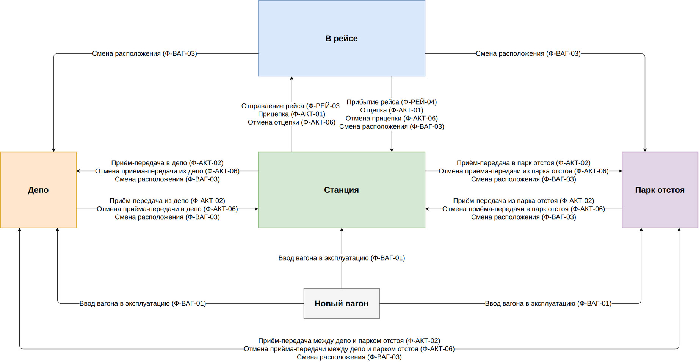
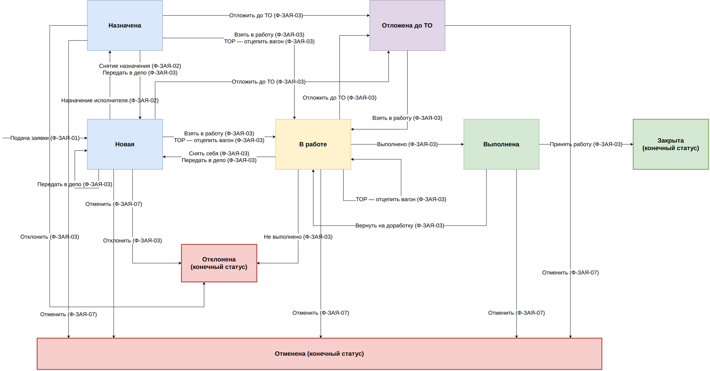

# zhsr: техническое задание - функции

- Функция, которая меняет расположение или состояние вагона, закрывает текущую запись журнала и открывает новую.
- Роль пользователя определяется: в рейсе - по бригаде рейса (`trip_crew`), если рейса в статусе "выполняется" нет -
  по роли в системе (`usr_role`).
- Каждый пользователь привязан к какому-то месту (`usr_depot`); службы пользователя - службы его ролей
  (`role_type.service`); у части ролей службы нет.

## 0. Общее поведение интерфейса

- **Списки:**
    - прокрутка - внутри таблицы, а не всей страницы; заголовок таблицы закреплён;
    - фильтры-переключатели допускают выбор нескольких значений; ничего не выбрано - фильтр не действует; повторный
      клик снимает значение;
    - поля ввода и комбобоксы имеют бледный крестик очистки; элемента "Все..." в списках нет;
    - предустановленный фильтр показан отдельным чипом; снимается крестиком на чипе;
    - выбор периода - переключатель предустановок (Сегодня, 3 дня, Неделя, Месяц) и произвольный интервал "с ...
      по ...";
- **Правая панель записи:**
    - клик по строке списка открывает справа панель со статической информацией записи и кнопками функций;
    - при ширине экрана от 1200px панель закреплена; при открытии раздела выбрана первая строка; при ширине меньше
      1200px панель плавающая той же ширины и открывается только по клику;
    - у плавающей панели повторный клик по выбранной строке снимает выделение; у закреплённой - не снимает;
    - Esc и крестик закрывают панель и снимают выделение;
    - при переходе в функцию записи (состав поезда, журнал вагона, отцепка и прицепка) панель остаётся на месте
      и не закрывается; при возврате из экрана функции выделение строки сохраняется, пока приложение открыто; переход
      пунктом левого меню открывает раздел без выделения;
    - кнопка "Редактировать" - под атрибутами записи, до первого разделителя, прижата вправо;
- **Экраны функций** (состав поезда, журнал вагона, отцепка и прицепка, редактор маршрута, новая заявка): левое
  меню скрыто; слева вверху - кнопка "назад" в квадрате и заголовок экрана; кнопка "назад" и Esc возвращают туда,
  откуда пользователь перешёл на экран (например, из списка рейсов в состав поезда - обратно в список рейсов); если
  экран открыт по ссылке или страница обновлена - в список своего раздела;
- **Левое меню:** при ширине экрана от 1400px раскрыто, иначе - узкая панель из иконок; клик по пустому месту меню
  переключает вид; счётчики у пунктов - число записей, требующих внимания: у "Заявок" - заявки, которые ждут действия
  лично пользователя (столько же, сколько в списке "мне на исполнение", Ф-ЗАЯ-06), у "Передачи" -
  акты в статусе "ожидает приёма", которые пользователь может принять (Ф-АКТ-02);
- **Права:** кнопки показываются всегда; кнопка недоступного действия неактивна, и в интерфейсе видно почему;
- **Диалоги и выпадающие списки** закрываются по Esc и кликом мимо; ошибку действия и проверки полей диалог
  показывает полосой над кнопками, диалог остаётся открытым; ошибку убирают крестик и ввод (набор текста, выбор
  значения), клавиши без ввода, щелчки и смена фокуса её не убирают; подписей с проверками под полями нет;
- **Дата и время** показываются вместе: перенос строки не отделяет дату от времени;
- **Порядок показа в администрировании:** таблица с порядком показа по умолчанию отсортирована по нему; колонка
  порядка показа содержит кнопки "выше" и "ниже", кнопки переставляют строку среди строк её группы (пункт - среди
  пунктов своего раздела); при сортировке по другой колонке кнопки неактивны;
- **Выбор неисправности:** на десктопе и на телефоне неисправность выбирается одним полем выбора; выпадающий список -
  дерево "служба-исполнитель → группа → неисправность": службы и группы - заголовки, выбрать их нельзя; набор текста
  отбирает неисправности; частые неисправности - избранные неисправности (`fault_type_favorite`);
- **Поля выбора:** список значений выбирается полем выбора с поиском, на телефоне и на десктопе одинаково; стрелки
  вверх и вниз ходят по значениям, Enter выбирает значение, Esc закрывает список и не закрывает диалог;
- **Уведомления:** всплывающих сообщений нет; результат действия виден в списке, панели и журнале.
- **Ответственные за вагоны:** у вагона может быть несколько ответственных, у сотрудника - несколько вагонов. При
  каждой передаче вагонов (передача, прицепка, отцепка, смена расположения) пользователь выбирает ответственных
  (несколько сотрудников) или явно нажимает "ответственный не назначен"; без выбора действие не выполняется; в
  списке выбора у сотрудника подписано, кто он: член бригады рейса поезда вагона (с должностью) или сотрудник депо
  станции. Ответственных за вагоны рейса назначают в окнах отправления и прибытия и отдельным действием (Ф-РЕЙ-08);
  без передачи ответственных вагона меняет мастер депо станции вагона (Ф-ВАГ-07). Смена ответственных отдельным
  действием выглядит как назначение исполнителя заявки (Ф-ЗАЯ-02): строка "Ответственные" со ссылкой "Назначить"
  ("Сменить"), выбор - во всплывающем окне на десктопе и в листе снизу на телефоне; первым в списке - "Не назначен";
  сотрудников выбирают нажатием, подсвечено может быть несколько.

## 1. Вагоны (ВАГ)

### Ввод вагона в эксплуатацию (Ф-ВАГ-01)

- **Кто:** администратор.
- **Действия:** пользователь вводит номер, тип, модель, год постройки, дату ввода в эксплуатацию, депо приписки и
  паспортные данные вагона и задаёт начальные расположение и состояние вагона. Система создаёт вагон и открывает
  первые записи журналов расположения и состояния; ответственных у нового вагона нет. Пользователь указывает пробег вагона на момент ввода, км.
- **Правила:**
    - номер вагона состоит из 5-20 знаков - цифр и дробной черты - и не повторяется;
    - начальное расположение - станция, депо или парк отстоя;

### Редактирование вагона (Ф-ВАГ-06)

- **Кто:** администратор.
- **Действия:** пользователь исправляет атрибуты вагона - те же, что при вводе (Ф-ВАГ-01), или указывает дату вывода
  из эксплуатации.
- **Правила:**
    - атрибуты исправляются, только если вагон ни разу не входил в состав рейса и в акты; иначе указывается только
      дата вывода из эксплуатации;
    - дата вывода из эксплуатации - не больше текущей;
    - при указании даты вывода Система переводит вагон в состояние "отставлен" (парк "исключён").

### Исправление данных вагона (Ф-ВАГ-08)

- **Кто:** администратор.
- **Действия:** пользователь исправляет данные вагона - те же, что при вводе (Ф-ВАГ-01): технологическое
  редактирование. Система сохраняет данные; изменённые расположение и состояние Система записывает в журналы вагона
  текущим временем.
- **Правила:**
    - данные исправляются независимо от рейсов и актов вагона;
    - модель, депо приписки и расположение могут быть не заданы; заданное расположение не очищается;
    - изменение расположения и состояния - ручная правка (`wagon_edit`) без комментария; ответственные за вагон не
      меняются;
    - у вагона в рейсе расположение и состояние не исправляются; у вагона, который ждёт приёма по акту, не
      исправляется расположение;
    - при изменении пробега на момент ввода Система пересчитывает общий пробег.
- **Поведение интерфейса:** пункт "Исправить данные вагона" в меню строки списка вагонов открывает окно ввода вагона,
  заполненное данными вагона.

### Смена состояния (Ф-ВАГ-02)

- **Кто:** администратор, планировщик вагонов.
- **Действия:** пользователь выбирает новое состояние вагона и пишет комментарий. Система закрывает текущую запись
  состояния и открывает новую.
- **Правила:** без комментария состояние не меняется; расположение вагона при смене состояния не меняется.

### Смена расположения (Ф-ВАГ-03)

- **Кто:** администратор, планировщик вагонов.
- **Действия:** пользователь выбирает новое расположение вагона и пишет комментарий. Система закрывает текущую запись
  расположения и открывает новую.
- **Правила:**
    - новое расположение - станция, депо или парк отстоя;
    - без комментария расположение не меняется; состояние вагона при смене расположения не меняется;
    - пользователь выбирает ответственных за вагон: сотрудников депо станции нового расположения (`usr_depot`) или явно
      "ответственный не назначен";
    - вагон в рейсе и вагон, который ждёт приёма по акту, расположение вручную не меняют.

### Смена ответственных за вагон (Ф-ВАГ-07)

- **Кто:** мастер депо станции вагона (`usr_depot`); администратор.
- **Действия:** пользователь выбирает вагону ответственных (несколько сотрудников) или снимает всех ("ответственный
  не назначен") - без акта и без смены расположения. Система закрывает текущую запись факта журнала ответственных и
  открывает новую текущим временем (при снятии всех - не открывает); запись ручной правки (`wagon_edit`) - без
  комментария.
- **Правила:**
    - ответственные - сотрудники депо станции вагона (`usr_depot`) и члены бригады последнего и ближайшего рейса
      поезда вагона; станция вагона - сама станция, станция депо или станция парка отстоя;
    - вагон в рейсе ответственных так не меняет: в рейсе ответственных меняют Ф-РЕЙ-08, окна отправления и прибытия
      и прицепка и отцепка (Ф-РЕЙ-03, Ф-РЕЙ-04, Ф-АКТ-01);
    - вагон, который ждёт приёма по акту, ответственных так не меняет: ответственных выбирают в акте (Ф-АКТ-02);
    - в журнале вагона (Ф-ВАГ-05) основание записи - ручная правка: кто и когда сменил ответственных.
- **Поведение интерфейса:**
    - панель вагона: в строке "Ответственные" - ссылка "Назначить" (ответственных нет) или "Сменить"; выбор - во
      всплывающем окне выбора сотрудника, подсвечено может быть несколько, с кнопкой "Назначить себя" (добавляет себя к выбранным);
    - нельзя сменить - ссылки нет, под строкой - почему: вагон в рейсе, вагон ждёт приёма по акту, меняет мастер депо
      станции вагона.

### Чтение списка вагонов (Ф-ВАГ-04)

- **Кто:** все.
- **Действия:** пользователь указывает фильтр: станция (выбор из списка station), состояние вагона (wagon_status_type),
  расположение (location_type), рейс (trip). Система показывает список вагонов: все атрибуты вагона, а также
  текущее расположение (станция, депо, парк отстоя, рейс) и состояние вагона. При выборе рейса выпадает список, где
  указаны рейсы в статусе "выполняется", с атрибутами их маршрута.
- **Правила:**
    - предустановленные фильтры зависят от роли и от ситуации:
        - пользователь в бригаде рейса (`ЛНП`, `ПЭМ`, проводник) - фильтр установлен в рейс пользователя;
        - рейс пользователя - рейс в статусе "выполняется", в бригаде которого он состоит, а если такого нет -
          ближайший по `planned_dt` рейс в статусе "план", в бригаде которого он состоит (как в Ф-ЗАЯ-01);
        - для роли `мастер депо` станция установлена в ту, за которой он закреплён.
    - поиск по номеру вагона - отменяет все фильтры, в том числе предустановленные по роли: поиск идёт только по
      номеру. Фильтры становятся неактивными, но не очищаются;
    - видимость по роли действует и при поиске по номеру: поиск идёт среди вагонов, видных пользователю;
    - проводник видит все вагоны состава своего рейса.

- **Поведение интерфейса:**
    - при вводе номера фильтры скрываются, вместо них надпись "При поиске по номеру фильтры не применяются.";
    - расположение показывается как "Название • вид расположения"; для вагона в рейсе - "Рейс N от дд.мм" без вида;
    - расположение и состояние показываются с датой начала и длительностью: "с 25.10 01:05, 8 час 25 мин"; от 10
      дней длительность - без часов;
    - в колонке расположения третьей строкой - текущие ответственные: "ответственные: ФИО, ФИО" или "ответственный: не
      назначен";
    - панель вагона: расположение, состояние и ответственные с датой и длительностью; общий пробег, км; акт приёма-передачи, ожидающий приёма, и куда
      передаётся вагон; паспорт; поезд вагона; блок "Рейсы" - рейс в статусе "выполняется" и ближайший рейс в статусе
      "план" поезда вагона, ссылкой на состав поезда с этим рейсом (Ф-ПОЕ-02); ссылки "Рейсы вагона (N)" (Ф-РЕЙ-00) и "Заявки вагона
      (N)" (Ф-ЗАЯ-06) - переход в список с фильтром по вагону, N - сколько строк будет в списке;
    - действия с вагоном - в меню строки списка: "Журнал вагона", "Передать на станцию", "Передать в депо", "Передать
      в парк отстоя" (Ф-АКТ-02); двойной клик по вагону - журнал вагона.

### Чтение журнала вагона (Ф-ВАГ-05)

- **Кто:** все.
- **Действия:** пользователь выбирает вагон и период. Система показывает всю историю изменений за выбранный период:
  откуда и куда вагон переместился (расположение), когда и на каком основании, как менялось состояние, кто назначен
  ответственными за вагон (факт). Выделена строка на выбранный момент времени.
- **Правила:** основание - документ, который открыл запись журнала; запись без основания открыта вводом вагона или
  ручной правкой.

- **Поведение интерфейса:**
    - период - как в списке рейсов, с предустановками "текущий месяц", "прошлый месяц";
    - фильтры по расположению и состоянию; колонки и фильтры идут в порядке: расположение, затем состояние.

## 2. Маршруты (МАР)

### Создание маршрута (Ф-МАР-01)

- **Кто:** администратор; планировщик вагонов.
- **Действия:** пользователь создаёт новый маршрут, попадает в окно редактированя. Указывает номер поезда, сообщение,
  дату начала действия маршрута, признак "разовый" и нормы часов для членов бригады (проводник, ЛНП, ПЭМ). Вводит
  остановки по порядку и время на них. Система сохраняет маршрут; изменения сразу доступны при создании и просмотре
  рейсов.
- **Правила:**
    - маршрутная сеть задаётся справочниками станций (`station`), перегонов (`stage`) и депо (`depot`);
    - маршрут - последовательность остановок;
    - узловая станция - станция, на которой есть депо;
    - начальная и конечная станции маршрута могут быть неузловыми: система показывает предупреждение "Начальная
      станция ... не является узловой - не имеет депо" (для конечной - "Конечная станция ...") и разрешает сохранить маршрут;
    - начальная станция выбирается из всех станций маршрутной сети; каждая следующая остановка - любая станция, достижимая по маршрутной сети
      от предыдущей остановки;
    - при выборе станции путь от предыдущей остановки прокладывается по кратчайшему пути; станции следования не
      становятся остановками;
    - система не добавляет остановки сама - ни при выборе дальней станции, ни при удалении остановки;
    - остановку можно вставить после любой станции маршрута; можно удалить любую остановку;
    - при удалении промежуточной остановки путь маршрута не меняется: удалённая остановка показывается как станция
      следования между соседними остановками; общий километраж сохраняется;
    - при вставке остановки или смене станции путь перестраивается только на затронутых перегонах; последующие
      остановки сохраняются;
    - одна и та же станция может идти подряд, только если между ними есть станции следования (например, `Кокшетау ->
      Петропавловск -> Кокшетау` без остановки в Петропавловске);
    - километраж считается автоматически, нарастающим итогом по сохранённому пути между остановками; вручную не
      вводится;
    - порядок остановок вручную не меняется - только вставкой и удалением;
    - у начальной станции пользователь вводит время отправления, у промежуточных - время прибытия, стоянку и время
      отправления, у конечной - время прибытия;
    - время станции хранится в минутах от полуночи дня отправления с начальной станции; 1440 и больше - следующие
      сутки;
    - время станций следования система считает сама - по расстоянию между отправлением с предыдущей остановки и
      прибытием на следующую;
    - время в пути маршрута система считает сама: прибытие на конечную станцию минус отправление с начальной;
      пользователь его не вводит;
    - при выборе станции система подставляет время в пути от предыдущей остановки по расстоянию (средняя скорость);
    - сохранение запрещено, если: не указан номер поезда; меньше двух остановок; одна станция дважды
      подряд без станций следования между ними; не указано время остановки; время по остановкам убывает;
    - нормы часов могут быть дробными, не больше двух знаков после запятой; пользователь вводит дробные часы (`2,5`)
      или часы и минуты (`2:30`), система показывает введённое значение как `2:30`;
    - если сообщение не указано, оно формируется автоматически из названий остановок через тире.
- **Поведение интерфейса:**
    - между соседними остановками виден путь по маршрутной сети - показаны все существующие станции следования (поезд
      проходит их без остановки);
    - в списке выбора станции упорядочены сначала по числу перегонов от предыдущей остановки (ближайшие соседи, затем
      через одну и т.д.), внутри - по расстоянию; у каждой станции показано расстояние от предыдущей остановки (`+N км`)
    - и станции следования ("через ..."); узловые выделены жирным и помечены "узловая";
    - над формой показана схема маршрута: остановки - синие кружки и жирный текст, станции следования - серые кружки
      и серый текст; в сокращённом виде между остановками показано число станций следования (`-> N ->`); переключение
      полного и сокращённого вида - кликом по схеме;
    - пользователь вводит время суток как `чч:мм`, редактор показывает время так же; введено время раньше отправления с
      предыдущей остановки - редактор считает это время временем следующих суток (`01:00` после `23:00` - через 2 часа);
    - время по остановкам убывает - редактор показывает это под остановками;
    - времена остановки связаны: изменение прибытия сдвигает отправление (стоянка прежняя), изменение стоянки сдвигает
      отправление, изменение отправления сдвигает прибытие (стоянка прежняя); время следующих остановок редактор
      сдвигает на ту же разницу;
    - у промежуточных остановок редактор показывает пройденный путь (км) и время в пути от отправления с начальной
      станции; под остановками - итог: время в пути маршрута;

### Редактирование маршрута (Ф-МАР-02)

- **Кто:** администратор; планировщик вагонов.
- **Действия:** пользователь открывает существующий маршрут на редактирование, далее как в Создание маршрута (Ф-МАР-01):
  вводятся те же атрибуты; либо указывает дату окончания действия маршрута.
- **Правила:**
    - атрибуты исправляются, только если по маршруту нет ни одного рейса; иначе указывается только дата окончания
      действия;
    - дата окончания действия - не больше текущей.

- **Поведение интерфейса (список маршрутов):**
    - фильтры: вид (регулярный, разовый), состояние (действующие, закрытые); по умолчанию - действующие;
    - закрытые маршруты показаны бледнее, с периодом действия;
    - одинарный клик - панель маршрута (схема остановок, атрибуты, нормы часов, "Редактировать"); двойной клик -
      редактор маршрута.

## 3. Поезда (ПОЕ)

Поезд - вагоны, сцепленные вместе. Поезд ходит из рейса в рейс по разным маршрутам, состав поезда почти не меняется.
Прицепка и отцепка бывают фактом (уже совершились) и планом (совершатся на указанной станции в указанное время).

### Чтение списка поездов (Ф-ПОЕ-00)

- **Кто:** все.
- **Действия:** пользователь указывает состояние поезда (действующие, расформированные) или ищет по обозначению поезда
  и номеру вагона. Система показывает список поездов: обозначение, число вагонов, вагоны по порядку, станцию вагонов
  поезда, текущий рейс поезда и ближайший рейс поезда в статусе "план".
- **Правила:** по умолчанию Система показывает действующие поезда.

- **Поведение интерфейса:**
    - экран "Поезда" - пункт левого меню под пунктом "Маршруты";
    - колонки: "Поезд" (обозначение жирным, под ним серым - число вагонов), "Где вагоны", "Ближайший рейс" (рейс в статусе
      "выполняется", а если его нет - ближайший рейс в статусе "план"; после рейса - плашка статуса);
    - клик по строке открывает панель поезда: вагоны по порядку с расположением, плановые прицепки и отцепки, блок
      "Текущий и будущие рейсы" - рейс в статусе "выполняется" и все рейсы в статусе "план"; рейсы поезда видны тому, кому
      виден поезд (сейчас поезда видны всем), - для просмотра состава, бригады и ответственных, даже если в списке
      рейсов сотрудник этот рейс не видит; менять рейс может только тот, кто видит его в списке рейсов; тот же блок - в панели экрана состава поезда; в режиме журнала "Прошлое" экран состава
      показывает в панели блок "Прошлые рейсы" (выполненные, сначала последний; в режиме "За период" - прибывшие за
      тот же период), выпадающий список "Рейс" - тоже прошлые рейсы; под атрибутами - кнопка "Редактировать" (обозначение
      поезда, Ф-ПОЕ-01), как на экране состава поезда: у пользователя без права и у расформированного поезда кнопка
      неактивна, причина - в подсказке; кнопка "Состав поезда" открывает экран состава
      поезда (Ф-ПОЕ-02); двойной клик по строке - экран состава поезда.

### Создание поезда (Ф-ПОЕ-01)

- **Кто:** планировщик вагонов; администратор.
- **Действия:** пользователь вводит обозначение поезда. Система создаёт поезд без вагонов. Пользователь исправляет
  обозначение действующего поезда.
- **Правила:** обозначение не повторяется среди действующих поездов.

- **Поведение интерфейса:**
    - кнопка "+ Поезд" на экране "Поезда" открывает диалог обозначения поезда;
    - ссылка "Собрать новый поезд" в диалоге рейса (Ф-РЕЙ-01) открывает тот же диалог; после сохранения Система
      выбирает новый поезд в диалоге рейса.

### Состав поезда (Ф-ПОЕ-02)

- **Кто:** планировщик вагонов; администратор. Остальные - просмотр.
- **Действия:** пользователь видит состав поезда сейчас и журнал прицепок и отцепок поезда; выбор записи журнала
  показывает состав на время записи. Пользователь прицепляет вагоны к поезду на позицию и отцепляет вагоны фактом или
  планом. Ожидающий план пользователь отмечает выполненным или отменяет. Ошибочный факт пользователь удаляет.
- **Правила:**
    - состав поезда строится по технике «журнал и состояние» ([journal-state-plan-fact.md](db-doc/journal-state-plan-fact.md)):
      журнал прицепок и отцепок - факты и планы, состав - история по факту и ожидаемый состав по плану;
    - функция меняет поезд вне рейса; поезд в рейсе в статусе "выполняется" меняется прицепкой и отцепкой в рейсе
      (Ф-АКТ-01);
    - фактом прицепляется только вагон, который стоит на той же станции, что и вагоны поезда: на самой станции, в
      депо или в парке отстоя этой станции; к поезду без вагонов фактом прицепляется любой вагон не в рейсе; другие
      вагоны пользователь прицепляет только планом;
    - прицепка ставит вагоны подряд с выбранной позиции, вагоны с неё сдвигаются назад; по умолчанию - в конец;
      отцепка сдвигает вагоны за отцепленным вперёд; отдельной перестановки нет: перестановка - отцепка и прицепка на
      новую позицию;
    - позиция выбирается по составу на время прицепки: у факта - по текущему составу, у плана - по ожидаемому;
    - фактом отцепляется вагон, который сейчас в поезде; планом - вагон, который есть в ожидаемом составе на время
      отцепки;
    - прицепляется только вагон рабочего парка ([park_type.tsv](../zhsr-database/src/main/resources/db/dict/park_type.tsv));
    - фактом не прицепляется вагон, который по факту находится в другом поезде; ожидающие планы других поездов
      прицепке фактом и отметке плана не мешают;
    - Система не сохраняет план, который создаёт противоречие планов вагона (Ф-ПОЕ-03); незавершённый план Система
      сохраняет и показывает неготовности вагона (Ф-ПОЕ-03);
    - прицепка и отцепка вне рейса не меняют расположение вагона;
    - время факта Система заполняет текущим, пользователь может его изменить; время факта - не позже текущего и не
      раньше последнего факта поезда и вагона; плановое время - в будущем;
    - прицепка, отцепка и отметка плана: пользователь указывает основания и примечания (приказ, причину); отметка
      плана по умолчанию берёт основания плана;
    - факт прицепки или отцепки без отметки плана отрабатывает ожидающий план того же вида у этого вагона в этом
      поезде - того же рейса или с плановым временем не позже факта: план не остаётся просроченным; будущий план
      другого рейса или вне рейса остаётся ожидающим; удаление факта снова делает план ожидающим;
    - отменённый план пользователь, который может отменить план, возвращает: план снова ожидает; проверки - как у
      нового плана на его время;
    - отметка плана: пользователь указывает фактическое время, может исправить станцию плана вне рейса и позицию
      прицепки; план остаётся с плановыми временем и местом, отклонение видно в журнале;
    - при отцепке вагона Система отменяет у этого вагона планы ответственных (на рейс и после рейса) во всех рейсах
      поезда в статусе "план"; проводники этого вагона становятся нераспределёнными;
    - Система расформировывает поезд, когда отцеплен последний вагон поезда и у поезда нет ожидающих плановых
      прицепок;
    - к расформированному поезду планировщик вагонов прицепляет вагоны фактом или планом: прицепка снова открывает
      поезд; если действует другой поезд с тем же обозначением, Система не открывает поезд и сообщает об этом;
      отцепка и переименование расформированного поезда недоступны;
    - удаляется факт, после которого вагон больше не прицепляли и не отцепляли ни в каком поезде и после которого
      поезд не ходил в рейс; прицепки и отцепки других вагонов не мешают; Система удаляет факт без истории, состав с
      этого времени строится заново по оставшимся фактам, отработанный фактом план снова ожидает; удаление факта прицепки отменяет у вагона планы
      ответственных рейсов поезда в статусе "план".

- **Поведение интерфейса:**
    - экран состава поезда открывается без левого меню: слева - журнал, в середине - состав, справа - панель поезда;
      журнал виден всегда; в шапке - кнопки "Отцепить вагоны" и "Прицепить вагоны"; в панели поезда - кнопка
      "Редактировать" (обозначение поезда, Ф-ПОЕ-01); блока "Вагоны" в панели поезда на этом экране нет: состав - в
      середине экрана;
    - состав - таблица: позиция и колонки "Номер", "Тип", "Расположение", "Состояние", как в списке вагонов (Ф-ВАГ-04); Система
      показывает строго состав на момент, без вагонов, которых в этот момент нет в поезде;
    - над журналом - переключатель "Настоящее" / "Прошлое", под ним - подпись "Журнал отцепок и прицепок" (как подпись
      состава справа); в режиме "Прошлое" - переключатель "Последние для вагона" / "За период", у "За период" - период:
      "Неделя", "Месяц", "3 месяца", "Год"; в рамке - заголовки колонок "Время" и "Событие";
    - режим "Прошлое": факты по времени ("Последние для вагона" - последний факт каждого вагона, "За период" - факты
      периода), под ними - строка "Текущее состояние"; режим "Настоящее": сверху - строка "Текущее состояние", под ней -
      ожидающие планы по времени; список прокручен к строке "Текущее состояние";
    - между записями журнала Система показывает отметки рейсов поезда: "Отправление рейса <номер поезда>" и "Прибытие
      рейса <номер поезда>" - всегда со своим временем; в режиме "Прошлое" - фактические отправления и прибытия, в режиме "Настоящее" - плановые
      отправления рейсов в статусе "план" и плановые прибытия рейсов в статусе "план" и "выполняется" с пометкой "по
      расписанию"; отметки показаны всегда, в режиме "За период" - за тот же период, при выбранном рейсе - только отметки
      этого рейса; записи в один момент с отправлением стоят перед отправлением: это прицепки и отцепки на станции
      отправления, без отметки которых рейс не отправляется; записи в один момент с прибытием стоят после прибытия;
    - отметка - не изменение состава: без меню, оформлена разделителем (пунктирная черта сверху), фон и цвет текста - обычные; клик по отметке показывает
      состав на её момент (у фактической - по факту, у плановой - ожидаемый) с подписью "Состав на момент отправления
      рейса <номер поезда>, <время>" или "Состав на момент прибытия рейса ..."; выбор записи журнала снимает выбор
      отметки, и наоборот;
    - строка "Текущее состояние" - как запись журнала: в колонке "Время" - текущее время, Система обновляет его каждую
      минуту, в колонке "Событие" - "Текущее состояние"; строка выделена только жирным шрифтом;
    - у записи журнала - время, вид ("Прицепка" или "Отцепка", без знаков "+" и "−"), "вагона
      <номер>" и позиция, слово вида - обычным цветом; под ними - отклонение от плана ("по плану 22.11 20:10"); затем место
      ("Станция: ...", в рейсе - ниже строкой "Рейс: <номер поезда> от <плановое отправление>", номер - мягкой
      ссылкой: выбрать этот рейс), просрочка плана, основания серым; время, равное времени записи выше, Система не
      повторяет;
    - клик по записи журнала показывает состав на её время: у факта - по факту, у плана - ожидаемый; вагон записи
      выделен; клик по строке "Текущее состояние" возвращает текущий состав;
    - в режиме "Настоящее" у состава - колонка "Запланировано": ожидающие планы вагона после выбранного момента (у текущего
      состава - все ожидающие планы вагона), например "отцепка 05.12 23:49";
    - у вагона в меню строки - "Отцепить вагон": диалог "Отцепить вагоны", в котором вагон уже отмечен; у выбранного
      плана и у вагона, которого нет в поезде сейчас, диалог открыт планом; меню вагона Система показывает в режиме
      "Настоящее" всегда, в режиме "Прошлое" - у текущего состава;
    - записи журнала одного момента Система применяет к составу по одной: клик по записи показывает состав после этой
      записи и записей того же момента выше неё;
    - у записи журнала в меню - "Редактировать", "Отметить" и "Отменить план" у плана, "Редактировать" и "Удалить
      факт" у факта; недоступное - с причиной;
    - "Редактировать" у ожидающего плана открывает окно с теми же полями, что "Прицепить вагоны" / "Отцепить вагоны",
      заполненными значениями плана, без выбора вагонов: рейс и остановка или станция, плановое время, у прицепки -
      позиция в поезде, основания и примечания; Система проверяет исправленный план так же, как новый план на новое
      время; план исправляет тот, кто может его отменить;
    - "Редактировать" у факта открывает окно только с полем "Основания, примечания": время и место факта меняют журналы
      вагона, ошибочный факт пользователь удаляет и вносит заново; основания исправляет тот, кто может удалить факт;
    - над составом - поле "Рейс": рейсы поезда в статусе "план" и "выполняется" (Ф-РЕЙ-02); пустое поле - "Рейс не
      выбран", состав показан на текущий момент; выбранный рейс Система записывает в адрес экрана (`?trip=`): переходы
      к рейсу из списка рейсов, панелей вагона и поезда и журнала вагона открывают экран сразу с рейсом;
    - выбранный рейс показывает состав на отправление рейса: до отправления - ожидаемый по плану состав на плановое
      отправление, после отправления - состав по факту на фактическое отправление; подпись состава - "Состав на
      момент отправления рейса <номер поезда>, <время>";
    - выбранный рейс отбирает записи журнала: все записи рейса (факты и действующие планы) и записи вне рейса за период
      рейса - от конца предыдущего рейса поезда (фактическое прибытие, иначе плановое) до начала следующего рейса
      поезда (фактическое отправление, иначе плановое); нет предыдущего или следующего рейса - период с этой стороны
      не ограничен;
    - при выбранном рейсе журнал не делится на "Настоящее" и "Прошлое": вместо переключателя - одна нажатая кнопка
      "Выбранный рейс", её отжатие снимает выбор рейса; записи (факты и действующие планы) и отметки этого рейса
      (отправление и прибытие - фактические, если были, иначе плановые) идут одной шкалой по времени; если рейс идёт
      сейчас (между отправлением и прибытием), строка "Текущее состояние" стоит на своём месте по времени, клик по ней
      показывает текущий состав; у состава всегда есть колонка "Запланировано";
    - момент по умолчанию - отметка отправления рейса, она выделена; клик по записи или отметке показывает состав на
      её момент, рейс остаётся выбранным; выбор другого рейса снимает выбор записи;
    - когда выбран рейс, в составе на любой момент (и у рейса после отправления) - колонка "Готовность" с пунктами каждого вагона: пункты
      разделены небольшим вертикальным интервалом; у вагона с
      неготовностью (Ф-ПОЕ-03) Система показывает название неготовности - "На другой станции", "Нужна передача на
      станцию" или "В другом поезде" - и подробности: на какой станции окажется вагон ("окажется на станции <станция>"); в
      каком депо или парке отстоя стоит вагон; в каком поезде и рейсе вагон, когда выполнена или запланирована прицепка
      и запланирована ли отцепка;
    - у неготовности "Нужна передача на станцию" Система показывает ссылку "Оформить передачу" (акт передачи на станцию
      отправления, Ф-АКТ-02); ссылку используют мастер депо, приёмщик и администратор, у остальных ссылка неактивна,
      причина - в подсказке;
    - в колонке "Готовность" Система проверяет норму проводников каждого пассажирского вагона (Ф-РЕЙ-06): если норма
      вагона не выполнена, Система показывает предупреждение "Проводники не по норме" и ссылку "Назначить"; ссылка
      открывает окно "Ответственные за вагон <номер>" (то же, что в диалоге "Ответственные за вагоны", Ф-РЕЙ-08);
      выбор пользователя Система сразу сохраняет: у рейса до отправления - в плане ответственных на рейс, после
      отправления - фактом с текущего времени; ссылку используют начальник поезда
      рейса, планировщик вагонов, планировщик проводников и администратор, у остальных ссылка неактивна, причина - в
      подсказке; если у рейса нет поездной бригады, окно на вкладке "Поездная бригада" показывает "Бригада рейса не
      назначена";
    - в колонке "Готовность" Система проверяет по описям экипировки норму каждого вагона: если у вагона нет ни одной
      описи, Система показывает предупреждение "Опись не проводилась"; если в последней описи вагона по шаблону
      фактическое количество позиции меньше требуемого, Система показывает надпись "Недостача по 3 позициям" (число
      позиций этой описи) и ссылку "Опись" (название шаблона - в подсказке); пунктов столько, сколько таких описей;
      ссылка открывает
      раздел "Описи": в поиске - номер вагона, период - день этой описи, опись выбрана;
    - при выбранном рейсе до отправления плановое время прицепки и отцепки по умолчанию - отправление рейса, рейс
      предлагается первым в поле "В рейсе";
    - кнопка "Прицепить вагоны" открывает диалог выбора вагонов с
      переключателем "Планом" / "Фактом", местом, временем, позицией в поезде ("1 - перед 12345" ... "в конец") и
      полем "Основания, примечания"; список вагонов - вагоны станции прицепки (станцию пользователь выбирает один раз,
      в месте прицепки) во всех состояниях, кроме "Отставлен"; фильтра "Состояние" нет;
    - кнопка "Отцепить вагоны" открывает диалог того же размера и вида, что "Прицепить вагоны", с переключателем
      "Планом" / "Фактом" ("Фактом" не блокируется), местом, временем, полем "Основания, примечания" и вагонами с
      галочками: у факта - вагоны текущего состава, у плана - вагоны ожидаемого состава на указанное плановое время
      (время раньше последнего факта поезда - состав по факту на это время); колонки списка - "№", "Номер", "Тип",
      "Расположение" (сейчас), "Состояние", "Расположение на момент", как в "Прицепить вагоны";
    - поля обоих диалогов - двумя строками, без выравнивания полей строк друг под другом: в первой - "Прицепка" /
      "Отцепка" (выбор "Планом" / "Фактом" обязателен) и у плана "В рейсе"; во второй - станция, у прицепки
      "Позиция в поезде", время ("Время прицепки" / "Время отцепки" у факта, "Плановое время прицепки" / "Плановое
      время отцепки" у плана; по умолчанию - следующий полный час) и "Основания, примечания";
    - место плана в обоих диалогах: список "В рейсе" - рейсы поезда в статусе "план" в том же виде, что в фильтре
      "Рейс" списка вагонов, пустой выбор - вне рейса (заполнитель "вне рейса"); у выбранного рейса - станция из
      остановок рейса (в списке время стоянки справа) и плановое время; выбор рейса ставит плановое время на начало
      рейса, очистка выбора время не меняет; вне рейса - станция и плановое время;
    - проверки времени в обоих диалогах - ошибкой диалога при сохранении: факт - "Время не может быть в будущем",
      "Время не раньше <время последнего факта поезда>"; план - "Плановое время должно быть в будущем", "Плановое
      время вне периода рейса";
    - станцию, которую пользователь не меняет (факт вне рейса), диалог показывает неактивным полем выбора;
    - поле "Основания, примечания" - шириной как соседние поля, без заполнителя;
    - в расположении вагона в рейсе (список вагонов, панель поезда) Система пишет "Рейс: 1/2 • Астана — Алматы".

### Неготовности вагонов по планам (Ф-ПОЕ-03)

- **Кто:** все пользователи видят неготовности вагонов.
- **Действия:** Система вычисляет неготовности вагонов по планам и показывает неготовности пользователю до сохранения
  прицепки, в готовности рейса и в списке проблем планов. Система не хранит неготовности: после изменения планов Система
  вычисляет неготовности заново.
- **Правила:**
    - Система считает, что все ожидающие планы исполнятся: расчёт идёт по ожидаемому составу поездов;
    - неготовность "в другом поезде": вагон в нужный промежуток времени есть в ожидаемом составе другого поезда; Система
      называет каждый другой поезд, рейс другого поезда, время прицепки, выполнена или запланирована прицепка, и время
      запланированной отцепки, а если отцепка не запланирована - сообщает об этом;
    - если у вагона есть неготовность "в другом поезде", Система не проверяет расположение вагона;
    - неготовность "на другой станции": вагон окажется не на нужной станции, и нужен перегоночный рейс;
    - неготовность "нужна передача на станцию": вагон окажется на нужной станции, но в депо или в парке отстоя;
    - расположение вагона в будущем Система получает из текущего расположения: после запланированной отцепки вагон стоит
      на станции отцепки, после прибытия рейса поезда, в котором едет вагон, - на станции прибытия; из этих двух событий
      действует более позднее;
    - прицепке без запланированной отцепки вагон нужен с времени прицепки без конца, прицепке с запланированной отцепкой -
      до времени отцепки; рейсу вагон нужен от отправления до прибытия по расписанию, выполняющемуся рейсу - с
      настоящего момента; вагон, который рейс прицепляет планом на остановке, нужен с планового времени прицепки на
      станции остановки;
    - если отцепка вагона просрочена и не отмечена, а по факту вагон ещё в поезде, Система считает, что отцепка не
      запланирована;
    - противоречие планов - два пересекающихся пребывания вагона в разных поездах, у которых начавшееся раньше пребывание
      уже имеет время отцепки, или два пребывания с одним временем начала; Система не сохраняет прицепку, отцепку,
      исправление плана и возврат отменённого плана, если действие создаёт противоречие, и называет мешающую прицепку и
      время, когда вагон освободится;
    - незавершённый план - пересечение, при котором у начавшегося раньше пребывания нет отцепки: отцепку пользователь
      планирует позже; Система сохраняет незавершённый план и показывает неготовность "в другом поезде";
    - отмену плана отцепки Система не запрещает: без отцепки план становится незавершённым;
    - неготовности "на другой станции" и "нужна передача на станцию" не запрещают сохранить план; факт прицепки Система
      проверяет по правилам расположения Ф-ПОЕ-02 и Ф-АКТ-01.

- **Поведение интерфейса:**
    - диалоги прицепки и отцепки вагонов, отметки плана и исправления плана прицепки или отцепки, а на телефоне экран
      подтверждения плановой прицепки или отцепки показывают предупреждения: какие неготовности будут мешать планам
      участвующих вагонов, если пользователь сохранит действие; Система считает неготовности всех рейсов в статусе "план"
      и "выполняется" и всех плановых прицепок вне рейса этих вагонов, включая сохраняемый план, и для каждой
      неготовности называет рейс или плановую прицепку;
    - Система запрашивает предупреждения при открытии диалога и при изменении даты, станции, отмеченных вагонов или
      выбора "Планом" / "Фактом"; предупреждения только информируют и не запрещают сохранить действие;
    - предупреждения Система показывает под заголовком "После сохранения будут проблемы:" (перед отменой и возвратом
      плана и удалением факта - "После этого действия будут проблемы:") фразами вида "Вагон 17110 будет на станции
      Астана-1, а нужен будет на станции Нурлы Жол 26.11 в 09:35, для рейса 655/656."; фраза называет, где окажется
      вагон (на станции, в рейсе, в депо, в парке отстоя или в другом поезде с отметкой о запланированной отцепке), где,
      когда и для чего вагон нужен; номер вагона и станции Система выделяет жирным, номер рейса показывает мягкой
      ссылкой; ссылка открывает рейс в новой вкладке (на десктопе - состав поезда рейса, на телефоне - вагоны рейса);
      плановое отправление рейса Система пишет после номера ("для рейса 655/656 от 26.11 в 09:35"), только если
      отправление отличается от времени, когда нужен вагон; если у вагона несколько проблем, Система пишет номер вагона
      один раз и под номером перечисляет фразы по времени; в строке списка вагонов Система показывает фразу без номера
      вагона, а в списке вагонов на телефоне - простым текстом без выделения и ссылки;
    - причину, по которой действие сохранить нельзя, сервер сообщает после нажатия кнопки сохранения; диалог не
      повторяет проверки сервера;
    - окна удаления факта, а на телефоне листы отмены плана и отмены выполнения показывают такие же предупреждения о
      планах вагона после действия;
    - перед отменой плана на десктопе и перед возвратом отменённого плана на телефоне Система открывает окно с
      предупреждениями и просит подтвердить действие; если предупреждений нет, Система выполняет действие без окна;
      если Система не смогла получить предупреждения, окно показывает ошибку и позволяет выполнить действие;
    - в диалоге прицепки Система показывает предупреждения под номером каждого вагона списка, а под таблицей -
      предупреждения отмеченных вагонов, в том числе скрытых фильтром; в диалоге отцепки - под таблицей предупреждения
      отмеченных вагонов;
    - список проблем планов Система отдаёт запросом `GET /plan-problems?to=<время>` для отчёта и дашборда: рейсы в статусе
      "план" с плановым отправлением до указанного времени (в том числе просроченные), рейсы в статусе "выполняется" и
      ожидающие плановые прицепки вне рейса с плановым временем не позже указанного, у вагонов которых есть
      неготовности; пользователь видит рейсы по правилам видимости списка рейсов, а прицепки вне рейса видит, только если
      список рейсов пользователя не ограничен депо или рейсом пользователя; отдельного экрана для списка нет.

## 4. Рейсы (РЕЙ)

### Чтение списка рейсов (Ф-РЕЙ-00)

- **Кто:** все.
- **Действия:** пользователь указывает фильтр: маршрут (route), станция следования (выбор из списка station),
  номер вагона, состояние рейса, интервал времени. Система показывает список рейсов, для выбранных маршрутов, в
  указанном периоде, проходящих через выбранную станцию, с вагоном в поезде рейса.
- **Правила:**
    - предустановленные фильтры зависят от роли и от ситуации:
        - пользователь в бригаде рейса (`ЛНП`, `ПЭМ`, проводник) - фильтр установлен в маршрут рейса пользователя;
        - рейс пользователя - рейс в статусе "выполняется", в бригаде которого он состоит, а если такого нет -
          ближайший по `planned_dt` рейс в статусе "план", в бригаде которого он состоит (как в Ф-ЗАЯ-01);
        - для роли `мастер депо` станция установлена в ту, за которой он закреплён.

- **Поведение интерфейса:**
    - по умолчанию выбраны состояния "план" и "выполняется" и период "следующая неделя";
    - по умолчанию список отсортирован по плановому отправлению, от ранних рейсов к поздним;
    - период связан с состояниями: только будущие рейсы ("план", "выполняется") - период по умолчанию от сегодня на
      неделю вперёд; только "выполнен" - неделя назад; будущие и прошедшие вместе, в том числе без выбора состояний -
      "ближайшие": неделя назад и неделя вперёд;
    - варианты периода зависят от состояний и идут от мелких к широким: "сегодня", затем 3 дня, неделя и месяц в
      подходящую сторону; для обеих сторон - и прошедшие, и следующие, и "ближайшие";
    - выбор периода, целиком лежащего в прошлом, заменяет будущие состояния на "выполнен"; выбор периода в будущем
      заменяет "выполнен" на "план" и "выполняется";
    - рейс попадает в период, если идёт в нём: рейс в статусе "выполняется" виден и при отправлении раньше начала
      периода;
    - у рейса в статусе "план" колонка "Готовность" показывает пункты готовности (Ф-РЕЙ-02) цветными плашками -
      зелёной (пункт выполнен) или красной (не выполнен): поезд назначен и планы до отправления отмечены, вагоны на
      станции отправления, `ЛНП` и `ПЭМ` назначены, проводники по норме; у невыполненного пункта плашка называет
      причину и число вагонов; разное состояние - разными плашками своего цвета, одинаковое - одной: "Назначены ПЭМ
      и ЛНП" или "Нет ПЭМ и ЛНП", иначе две плашки, например "Нет ПЭМ" и "Назначен ЛНП"; поезд и планы - тоже
      отдельными плашками: "Поезд не назначен" (назначенный поезд плашки не имеет), "Не выполнены планы: 2 вагона", "Выполнены планы: 3 вагона" (прицепки и
      отцепки, выполненные фактом до отправления, - отмеченные планы и факты без плана: вне рейса после планового
      отправления предыдущего рейса поезда и самого рейса не позже его отправления); в поезде без
      вагонов пункт проводников - "Проводники не назначены";
    - неготовности вагонов рейса (Ф-ПОЕ-03) колонка "Готовность" показывает тремя красными плашками с числом вагонов, без
      номеров вагонов: "На другой станции: 2 вагона", "Нужна передача на станцию: 1 вагон", "В другом поезде: 1 вагон";
      подсказка плашки перечисляет вагоны и причины; если у вагонов рейса нет неготовностей, Система показывает зелёную
      плашку "Вагоны на станции";
    - плашка экипировки (в поезде есть вагоны): красная "Недостача по 3 позициям" - в последней описи экипировки
      хотя бы одного едущего вагона по какому-то шаблону фактическое количество позиции меньше требуемого, Система
      считает позиции без повтора по вагонам; иначе зелёная "Вагон экипирован"; вагон без описей даёт красную плашку "Опись не проводилась: 2 вагона", зелёная плашка - только когда описи
      есть у всех едущих вагонов и недостачи нет;
      недостача не блокирует отправку рейса;
    - у рейса в статусе "выполняется" колонка "Готовность" показывает пункты по текущему состоянию (состав - по
      факту): поезд, выполненные планы на станции отправления, `ПЭМ` и `ЛНП`, проводники; расположение вагонов Система
      не проверяет, из неготовностей вагонов показывает только "В другом поезде"; у рейсов в других статусах колонка
      пустая;
    - панель рейса: маршрут (ссылкой на редактор маршрута - только номер поезда маршрута, название - текстом),
      статус, вид рейса, поезд (без ссылки на состав поезда), плановое и фактическое отправление, схема маршрута (всегда компактная),
      время в пути и нормы часов; кнопка "Редактировать"; мягкие ссылки "Формирование поезда", "Отцепка", "Прицепка"
      (рейс в пути);
    - в панели рейса - блок "Поездная бригада": подпись, мягкая ссылка "Изменить" - диалог "Поездная бригада"
      (Ф-РЕЙ-06), ниже - список сотрудников бригады с должностью: `ЛНП`, `ПЭМ`, проводники;
    - в панели рейса - блок "Ответственные" (Ф-РЕЙ-08): подпись "Ответственные" и мягкая ссылка "Изменить" -
      диалог "Ответственные за вагоны"; строкой ниже - переключатель "На рейс" / "После рейса"; под ним - подпись "Ответственные с
      <дата и время>" (начало самых поздних показанных ответственных) и список "ФИО - вагон N": каждое ФИО на своей
      строке, номера вагонов выровнены колонкой; вагон без ответственных - "не назначен" (после рейса - "без плана");
    - действия с рейсом - в меню строки списка: "Формирование поезда", "Ответственные за вагоны", "Редактировать",
      "Отметить отправление" (план), "Отметить прибытие" (в пути), "Исправить отправление" и "Отменить отправление" (10 минут
      после отправления), "Исправить прибытие" и "Отменить прибытие" (10 минут после прибытия), "Отцепка",
      "Прицепка", "Отменить рейс" (план); недоступные - неактивны, причина - в подсказке;
    - двойной клик по рейсу - экран состава поезда с этим рейсом (Ф-ПОЕ-02); у рейса без поезда - сообщение "У рейса не
      назначен поезд";
    - фильтр по номеру вагона ищет по части номера и не отменяет остальные фильтры;
    - переход "Рейсы вагона" с панели вагона (Ф-ВАГ-04) устанавливает номер вагона, состояния "план" и "выполняется",
      сбрасывает период и остальные фильтры.
    - переход с карты диаграммы "Текущие рейсы" (десктоп, клик по значку поезда) устанавливает маршрут рейса,
      текущее состояние рейса ("выполняется" или "выполнен") и период рейса - с даты отправления по дату прибытия, у
      рейса в пути - по сегодня (это состояние период не заменяет), сбрасывает остальные фильтры и выбирает этот рейс.

### Создание рейса (Ф-РЕЙ-01)

- **Кто:** планировщик вагонов; администратор.
- **Действия:** пользователь выбирает маршрут, поезд и плановое отправление. Система создаёт рейс в статусе "план".
- **Правила:**
    - для поезда без расписания создаётся разовый маршрут;
    - рейс - поездка поезда по всем пунктам маршрута;
    - станция отправления рейса - первая остановка маршрута, станция прибытия - последняя;
    - поезд можно выбрать позже; рейс без поезда не отправляется;
    - поезд не выбирается, если поезд уже идёт в другом рейсе в статусе "план" или "выполняется" и время этих рейсов
      пересекается (плановое отправление плюс длительность маршрута).

- **Поведение интерфейса:**
    - переключатель "Маршрут из расписания" / "Разовый маршрут"; маршрут выбирается из списка в обоих случаях;
    - список маршрутов - комбобокс с поиском; каждая строка оформлена как строка таблицы маршрутов;
    - в списке только действующие маршруты; значение по умолчанию не подставляется;
    - ссылка "Создать новый маршрут" открывает редактор маршрута;
    - поезд выбирается из списка действующих поездов; в строке поезда - обозначение, число вагонов и станция вагонов;
      поезд, занятый в пересекающемся рейсе, показывается, но не выбирается, и рядом написано, в каком рейсе он занят;
    - ссылка "Собрать новый поезд" открывает создание поезда (Ф-ПОЕ-01).

### Редактирование рейса (Ф-РЕЙ-07)

- **Кто:** планировщик вагонов; администратор.
- **Действия:** пользователь исправляет атрибуты рейса - те же, что при создании (Ф-РЕЙ-01).
- **Правила:**
    - рейс исправляется, только если он в статусе "план"; иначе рейс не исправляется;
    - при смене планового отправления Система сдвигает время ожидающих планов прицепок и отцепок рейса на столько
      же, на сколько сдвинулось плановое отправление (если поезд и маршрут рейса не меняются), и пересчитывает
      ожидаемый состав поезда;
    - при смене поезда или маршрута Система отменяет ожидающие планы прицепок и отцепок рейса, как отмену плана
      пользователем; до сохранения диалог показывает над кнопками полосу предупреждения (как полосу ошибки) со
      списком отменяемых планов;
    - при смене поезда ожидающие планы прежнего поезда вне рейса до отправления (они мешали отправлению рейса)
      остаются у прежнего поезда; диалог показывает их списком в той же полосе предупреждения: "Останутся у прежнего
      поезда <поезд>: ..."; отменяемые планы рейса - под строкой "Будут отменены планы прежнего рейса <номер поезда маршрута>:"; записи
      в полосе - маркированным списком с отступом, обычным цветом шрифта, той же фразой, что в журнале ("Отцепка
      вагона 15030"), и временем через "•".

### Формирование поезда рейса (Ф-РЕЙ-02)

- **Кто:** планировщик вагонов - прицепка и отцепка на станции отправления у рейса в статусе "план", планы прицепки и
  отцепки на остановках рейса в статусе "план" или "выполняется"; начальник поезда - отметка планов своего рейса
  (Ф-АКТ-01); администратор - всё. Остальные - просмотр.
- **Действия:** пользователь видит вагоны поезда рейса на время рейса: до отправления - ожидаемый состав на
  отправление, в пути и после прибытия - состав по факту. Пользователь прицепляет вагоны к поезду на станции
  отправления и отцепляет вагоны, как в составе поезда (Ф-ПОЕ-02). Пользователь планирует прицепку и отцепку вагона на
  остановке маршрута рейса.
- **Правила:**
    - у рейса без поезда пользователь сначала выбирает поезд (Ф-РЕЙ-07);
    - прицепка на станции отправления до отправления - прицепка вне рейса по правилам Ф-ПОЕ-02: фактом или планом;
      план на станции отправления отмечает начальник поезда рейса (Ф-РЕЙ-03);
    - плановая прицепка и отцепка на остановке маршрута: остановка - любая, кроме станции прибытия; плановое время -
      время стоянки поезда на остановке по расписанию маршрута;
    - ожидаемый состав на отправление учитывает все изменения поезда до рейса: факты, ожидающие планы вне рейса и
      планы предыдущих рейсов поезда; план не становится фактом сам: факт вносит отметка;
    - плановую прицепку вагона, который нужен и другому поезду, Система проверяет по правилам противоречия и
      незавершённого плана (Ф-ПОЕ-03);
    - выбор вагонов для прицепки - функция `Чтение списка вагонов (Ф-ВАГ-04)`: по умолчанию - вагоны станции
      отправления (на самой станции, в депо или в парке отстоя этой станции); поиск по номеру находит вагон на любой
      станции;
    - при выборе вагонов для прицепки Система показывает у вагона предупреждения (Ф-ПОЕ-03); предупреждения не запрещают
      выбрать вагон; вагон, который уже в этом поезде, выбрать нельзя;
    - формирование поезда не меняет расположение вагонов;
    - после отправления поезд рейса меняется прицепкой и отцепкой в рейсе (Ф-АКТ-01).

- **Поведение интерфейса:**
    - отдельного экрана формирования рейса нет: поезд рейса пользователь формирует на экране состава поезда с выбранным
      рейсом (Ф-ПОЕ-02);
    - мягкая ссылка "Формирование поезда" в правой панели рейса, пункт меню строки и двойной клик по рейсу в списке
      открывают экран состава поезда рейса с этим рейсом; у рейса без поезда ссылка и пункт меню неактивны с причиной "У рейса не
      назначен поезд", двойной клик показывает это сообщение;
    - бригаду рейса пользователь меняет в диалоге "Поездная бригада" (Ф-РЕЙ-06), распределение по вагонам - в диалоге
      "Ответственные за вагоны" (Ф-РЕЙ-08); готовность пользователь видит в колонке "Готовность" списка рейсов,
      отправление отмечает пунктом "Отметить отправление" меню строки (Ф-РЕЙ-00);
    - у плана прицепки пользователь выбирает остановку маршрута рейса: станцию отправления или остановку в пути;
    - неготовности вагонов Система показывает в составе на отправление рейса в колонке "Готовность" (Ф-ПОЕ-02).

### Формирование бригады рейса (Ф-РЕЙ-06)

- **Кто:** планировщик вагонов - начальник поезда и ПЭМ рейса в статусе "план"; планировщик проводников -
  проводники рейса в статусе "план" и их распределение по вагонам; начальник поезда - распределение проводников своего
  рейса по вагонам (на телефоне - экраном "Ответственные за вагоны", Ф-РЕЙ-08); администратор - всё. Остальные - просмотр.
- **Действия:** пользователь добавляет в бригаду рейса сотрудников с должностью на рейсе (проводник, начальник поезда,
  ПЭМ) и убирает их; распределяет проводников по вагонам.
- **Правила:**
    - бригада меняется только у рейса в статусе "план";
    - бригада - роль на рейсе; распределение по вагонам - ответственные за вагоны на рейс (журнал ответственных): у
      рейса в статусе "план" - план ответственных на рейс с планового отправления, у рейса в статусе "выполняется" -
      факт; ответственных на рейс выбирают только из бригады рейса;
    - начальник поезда перемещает проводников между вагонами и у рейса в статусе "выполняется": перемещение - смена
      ответственных за вагоны временем, которое указал пользователь (по умолчанию - текущее, не позже текущего и не
      раньше чем сутки назад); проводники рейса при этом не меняются, норма проверяется так же;
    - сотрудник не добавляется в бригаду, если он уже входит в бригаду другого рейса в статусе "план" или
      "выполняется" и время этих рейсов пересекается (плановое отправление плюс длительность маршрута);
    - план ответственных на рейс правится, пока рейс не отправлен; при смене планового отправления (Ф-РЕЙ-07) план
      переносится на новое плановое отправление, при смене поезда и отмене рейса (Ф-РЕЙ-05) - отменяется; сотрудник,
      убранный из бригады, убирается из плана;
    - система показывает, все ли вагоны поезда переданы на станцию отправления; где какой вагон сейчас; для вагонов
      "в пути" показана дата/время планируемого нахождения на станции;
    - при отцепке вагона от поезда Система отменяет у этого вагона планы ответственных во всех рейсах поезда в статусе
      "план" (Ф-ПОЕ-02);
    - планировщик вагонов назначает Начальника поезда и ПЭМ;
        - начальник поезда и ПЭМ - не больше одного на рейс.
    - планировщик проводников назначает список проводников на весь поезд; проводник назначается на рейс без привязки
      к вагону, вагон указывается позже;
    - при формировании рейса должна соблюдаться норма: 2 проводника на 1 вагон или 3 проводника на 2 соседних вагона.
    - норма требуется только для пассажирских вагонов;
    - один проводник может обслуживать 1 вагон или 2 соседних;
    - начальник поезда распределяет проводников по вагонам на телефоне экраном "Ответственные за вагоны" (Ф-РЕЙ-08);
      отдельного экрана формирования рейса на телефоне нет;
    - хвостовые вагоны - первый и последний вагоны поезда; в них назначается по два проводника категории "старший
      проводник" (`usr_category`, [category_type.tsv](../zhsr-database/src/main/resources/db/dict/category_type.tsv));
    - система показывает, соблюдаются ли правила: укомплектован ли поезд личным составом: назначены ли `ЛНП` и
      `ПЭМ`, назначены ли проводники на все пассажирские вагоны поезда;

- **Поведение интерфейса:**
    - пользователь назначает начальника поезда, ПЭМ и проводников рейса в панели рейса списка рейсов (Ф-РЕЙ-00): блок
      "Поездная бригада", ссылка "Изменить" открывает диалог "Поездная бригада";
    - распределить проводников по вагонам;
    - диалог "Поездная бригада":
        - сверху диалог показывает рейс и станцию отправления;
        - ниже - поля "Начальник поезда" и "ПЭМ": выпадающие списки сотрудников с ролью `ЛНП` и `ПЭМ` строками "Списка
          ФИО"; сотрудник, занятый в пересекающемся рейсе, виден с пометкой "занят на рейсе ... до ...", назначить его
          Система не даёт; поля меняет планировщик вагонов, у остальных поля неактивны, причина - в подсказке;
        - ниже - список проводников строками "Списка ФИО": ФИО, категория ("Старший проводник" или "Проводник") и
          занятость; нажатие на строку отмечает проводника или снимает отметку; список меняет планировщик проводников,
          у остальных строки неактивны, причина - над списком;
        - в списке - проводники станции отправления и уже назначенные в рейс; назначенные отмечены;
        - проводники, занятые в другом рейсе, не показываются, кроме тех, кто освободится к отправлению: "в рейсе ...
          • свободен с ..." (окончание считается как отправление текущего рейса + время в пути по маршруту);
        - снятие отметки убирает проводника из бригады и с вагона;
        - под списком - "Отмечено: N"; кнопка "Сохранить" записывает начальника поезда, ПЭМ и проводников одной
          операцией: при ошибке Система не меняет ничего;
    - проводников по вагонам пользователь распределяет в диалоге "Ответственные за вагоны" (Ф-РЕЙ-08): у рейса в статусе
      "план" - план на рейс, у рейса в статусе "выполняется" - факт временем изменения;
    - снятый с вагона проводник остаётся в бригаде без вагона;
    - при перестановке вагонов назначение проводника не снимается; если его два вагона стали несоседними - в диалоге
      "Ответственные за вагоны" Система выводит предупреждение "назначен на несоседние вагоны", и эти вагоны не
      засчитываются в норму;
    - готовность рейса пользователь проверяет в колонке "Готовность" списка рейсов (Ф-РЕЙ-00); вагон должен стоять на станции
      отправления; если он в другом месте - передачу на станцию отправления пользователь оформляет ссылкой "Оформить
      передачу" в составе поезда с выбранным рейсом (Ф-ПОЕ-02).

### Отправление рейса (Ф-РЕЙ-03)

- **Кто:** начальник поезда - свой рейс; администратор.
- **Действия:** пользователь отмечает фактическое отправление рейса. Система записывает, кто и когда отметил
  отправление, переводит рейс в статус "выполняется", а вагоны поезда - в расположение "в рейсе" и в состояние "в
  пути".
- **Правила:**
    - отправление отмечается только у рейса в статусе "план";
    - рейс не отправляется без поезда и с поездом без вагонов;
    - рейс не отправляется, пока у поезда есть ожидающие планы до отправления - на станции отправления рейса и вне
      рейса не позже планового отправления: начальник поезда рейса отмечает каждый выполненным или отменяет
      (Ф-АКТ-01); план сам фактом не становится;
    - отправление - позже последнего факта прицепки или отцепки поезда;
    - рейс не отправляется, пока все вагоны поезда не переданы на станцию отправления; для вагона в депо или в парке
      отстоя Система предлагает сначала оформить `Передачу вагонов на станцию (Ф-АКТ-02)`;
    - рейс не отправляется, пока не назначены `ЛНП` и `ПЭМ`;
    - рейс не отправляется, пока в поезде есть вагон не рабочего
      парка ([park_type.tsv](../zhsr-database/src/main/resources/db/dict/park_type.tsv));
    - рейс не отправляется, пока не выполнена норма проводников (Ф-РЕЙ-06);
    - от отправления до прибытия вагоны поезда переходят в состояние "в пути";
    - отправление отрабатывает план ответственных на рейс (Ф-РЕЙ-06): Система записывает ответственных вагонов
      временем отправления по плану (у вагона без плана ответственных в пути нет), план - "отработан"; окно
      отправления на десктопе показывает план, его можно поправить - правка записывается вместо плана у своего вагона;
      на телефоне окно спрашивает только время - записывается план;
    - при отправлении Система отмечает заступление на дежурство всей бригады рейса временем отправления;
    - в течение 10 минут после отметки начальник поезда рейса может исправить время отправления или отменить
      отправление; отмена возвращает рейс в статус "план", а вагоны - в прежние расположение и состояние;
      ответственных отмена удаляет записанных отправлением и возвращает план ответственных в "ожидает", исправление
      времени переносит их время; новое время -
      раньше первого изменения вагонов после отправления (отцепки, прицепки, передачи, смены ответственных); если такие
      изменения были, отправление не отменяется, пока не отменены они.

- **Поведение интерфейса:**
    - отметить отправку рейса (кнопка в правой панели);
    - отмена отметки - кнопкой "Отменить отправление" ("Отменить прибытие") в шапке формы рейса, в панели и меню
      строки списка рейсов, на телефоне - кнопкой под плашками рейса; отмена - сразу, без окна; через 10 минут после
      отметки кнопка неактивна с пояснением; в окне исправления времени отмена тоже есть;
    - отправка рейса доступна, когда выполнены все пункты готовности: плановые прицепки и отцепки на станции
      отправления отмечены, вагоны на станции отправления, бригада назначена, норма проводников выполнена.

### Отметка о прибытии рейса (Ф-РЕЙ-04)

- **Кто:** начальник поезда - свой рейс; администратор.
- **Действия:** пользователь отмечает фактическое прибытие рейса. Система записывает, кто и когда отметил
  прибытие, ставит вагоны, которые едут в поезде, на станцию прибытия, переводит эти вагоны в состояние "в простое",
  а рейс - в статус "выполнен". Вагоны остаются в поезде.
- **Правила:**
    - прибытие отмечается только у рейса в статусе "выполняется";
    - дата прибытия позже отправления;
    - рейс не завершается, пока у рейса есть плановые прицепки и отцепки: начальник поезда рейса отмечает каждую
      выполненной или отменяет (Ф-АКТ-01);
    - вагоны, отцепленные в пути, остаются на станциях отцепки; их статус при прибытии не меняется;
    - пробег вагона в рейсе - сумма участков, которые вагон проехал в поезде: от станции отправления или прицепки до
      станции прибытия или отцепки, по километражу маршрута; Система вносит участки при прибытии и отцепке и
      пересчитывает общий пробег вагона;
    - прибытие отрабатывает план ответственных после рейса (Ф-РЕЙ-08): Система записывает ответственных вагонов
      временем прибытия по плану, план - "отработан"; у вагона без плана ответственные не меняются; окно прибытия на
      десктопе показывает план, а у вагона без плана - текущих ответственных; их можно поправить - правка записывается
      вместо плана у своего вагона; на телефоне окно спрашивает только время - записывается план;
    - после прибытия никто не обязан менять ответственных: начальник поезда или другой пользователь с правом меняет их
      в диалоге "Ответственные за вагоны" (Ф-РЕЙ-08), когда решит;
    - при прибытии Система отмечает окончание дежурства бригады рейса временем прибытия;
    - в течение 10 минут после отметки начальник поезда рейса может исправить время прибытия или отменить прибытие так
      же, как отправление (Ф-РЕЙ-03); отмена возвращает рейс в статус "выполняется", удаляет ответственных,
      записанных прибытием, и возвращает план ответственных после рейса в "ожидает"; исправление времени переносит их
      время.

- **Поведение интерфейса:**
    - если у рейса есть плановые прицепки и отцепки, окно прибытия показывает их списком с кнопками "Отметить" и
      "Отменить план"; кнопка "Отметить прибытие" неактивна, пока список не пуст;
    - окна отправления и прибытия на десктопе содержат таблицу ответственных (Ф-РЕЙ-08); на телефоне окно отметки
      спрашивает только время, ответственных меняют отдельными кнопками "Ответственные за вагоны" и "Ответственные
      после рейса" на главной (Ф-РЕЙ-08).

### Ответственные за вагоны рейса (Ф-РЕЙ-08)

- **Кто:** начальник поезда - свой рейс; планировщик вагонов, планировщик проводников (нарядчик), администратор -
  любой рейс.
- **Действия:** пользователь смотрит и меняет ответственных за вагоны поезда рейса: план ответственных на рейс, план
  ответственных после рейса и факт. План Система записывает без времени. Факт Система записывает так: у каждого
  изменённого вагона закрывает текущую запись журнала ответственных и открывает новую с выбранными сотрудниками (без
  сотрудников - не открывает).
- **Правила:**
    - план на рейс - с планового отправления (тот же, что меняет распределение проводников по вагонам, Ф-РЕЙ-06);
      правится у рейса в статусе "план";
    - план после рейса - с планового прибытия; правится у рейса в статусе "план" и "выполняется"; вагон без
      ответственных в плане после рейса - плана нет: после прибытия остаются ответственные рейса;
    - факт - текущие ответственные; меняется в любом статусе рейса, кроме "отменён", в том числе до отправления;
      время факта указывает пользователь (по умолчанию - текущее): не позже текущего, не раньше чем сутки назад и
      позже начала текущих ответственных изменённых вагонов; неверное время интерфейс не блокирует, а проверяет при
      сохранении и показывает ошибку;
    - факт до отправления не отменяет план на рейс: отправление отрабатывает план (Ф-РЕЙ-03), вагон без плана
      сохраняет ответственных по факту;
    - вагоны - вагоны поезда рейса, которые едут в поезде; у выполненного рейса - доехавшие до станции прибытия; факт
      до отправления - вагоны, которые поедут в поезде и не находятся в другом рейсе;
    - сотрудники: план на рейс и факт в пути - только бригада рейса (`trip_crew`); план после рейса, факт после
      прибытия - бригада рейса и сотрудники депо станции прибытия (`usr_depot`); факт до отправления - бригада рейса и
      сотрудники депо станции отправления; Система предлагает бригаду первой;
    - ответственные работают параллельно; пересмены интерфейс пока не показывает;
    - план правится, пока его не отработали.
- **Поведение интерфейса:**
    - в панели рейса списка рейсов (Ф-РЕЙ-00) - блок "Ответственные" с переключателем "На рейс" / "После рейса" и
      списком ответственных; ссылка "Изменить" открывает диалог "Ответственные за вагоны" (по "После рейса" - сразу на
      плане после рейса); тот же диалог - пункт "Ответственные за вагоны" меню строки списка рейсов;
    - десктоп: диалог "Ответственные за вагоны"; сверху в одну линию - переключатель "План" / "Факт" и время
      изменения; у плана между ними - переключатель "На рейс" / "После рейса", как в панели рейса;
    - план на рейс действует с планового отправления, план после рейса - с планового прибытия: время подставлено (плановое
      отправление или прибытие) и неактивно; план на произвольную дату не задаётся; недоступный по статусу рейса план
      неактивен: план на рейс - после отправления, оба плана - после прибытия;
    - факт - время вводит пользователь, переключателя момента нет;
    - у плана под переключателями - с какого времени он действует и из кого выбирают ответственных;
    - ниже - две таблицы рядом: слева "По вагонам" - позиция, вагон, ответственные, с какого времени; справа - подпись
      "По сотрудникам" и в той же строке переключатель "Поездная бригада" / "Сотрудники станции" (всегда, обе
      кнопки активны; нет сотрудников станции - пустой список "Нет сотрудников станции") и таблица сотрудников -
      сотрудник, должность, вагоны; у проводника, назначенного на два несоседних вагона, под вагонами - красное
      предупреждение "назначен на несоседние вагоны";
    - в конце каждой строки обеих таблиц - карандаш (размером и видом как три точки меню строки); клик по строке или
      карандашу: у вагона - окно выбора сотрудника с переключателем "Поездная бригада" / "Сотрудники станции",
      подсвечено может быть несколько; у сотрудника - окно выбора вагонов по вагонам поезда; без права изменять
      карандашей нет, таблицы только для просмотра, причина - над ними;
    - изменения копятся в диалоге, изменённые строки отмечены, под таблицами - "Изменено вагонов: N"; "Сохранить"
      записывает изменения плана без времени, факта - одним временем;
    - таблица ответственных встроена в окна отправления и прибытия на десктопе: сохраняется вместе с отметкой,
      временем отметки;
    - телефон: экраны "Ответственные за вагоны" и "Ответственные после рейса" по кнопкам на главной начальника поезда
      (вторая - пока рейс не прибыл); экран "Ответственные за вагоны" - у рейса в статусе "план" план на рейс, после
      отправления - факт; экран - мастер в 2 шага с полосками шагов в шапке, как подача заявки:
        - шаг 1: переключатель "Вагоны" / "Бригада" / "Сотрудники станции" (последний - когда есть сотрудники
          станции), строки вагонов или сотрудников; касание строки - выбор в листе снизу, подсвечено может быть
          несколько; внизу - "Отмена" и "Далее" (активна, когда есть изменения);
        - шаг 2: "Переназначить с" - время изменения (у плана - плановое отправление или прибытие, неактивно);
          прокручиваемый двухуровневый список "Назначены:" и "Сняты:" - строки "ФИО - вагон N", каждое ФИО на своей
          строке, номера вагонов выровнены колонкой; внизу - "Назад" и "Переназначить".

### Отмена рейса (Ф-РЕЙ-05)

- **Кто:** планировщик вагонов; администратор.
- **Действия:** пользователь отменяет рейс. Система переводит рейс в "отменён".
- **Правила:** отменяется только рейс в статусе "план"; расположение вагонов не меняется.

- **Поведение интерфейса:**
    - отмена рейса - кнопка в правой панели.

## 5. Акты (АКТ)

### Прицепка и отцепка в рейсе (Ф-АКТ-01)

Отцепка - выход вагона из поезда рейса; прицепка - вход вагона в поезд рейса.

- **Кто:** начальник поезда - свой рейс; мастер депо - рейсы в статусе "выполняется", маршрут которых проходит через
  станцию его депо; администратор.
- **Действия:**
    - пользователь отмечает выполненной плановую прицепку или отцепку рейса или отменяет план;
    - пользователь прицепляет или отцепляет вагоны сразу, без плана: выбирает вид (отцепка или прицепка), остановку
      маршрута и вагоны, у прицепки - позицию в поезде, указывает время, основания и примечания (приказ, причину);
    - при отцепке Система ставит расположение вагона на станцию остановки, переводит вагон в состояние "в простое",
      заканчивает участие вагона в поезде и вносит участок пробега вагона;
    - при прицепке Система переводит вагон в расположение "в рейсе" и в состояние "в пути" и начинает участие вагона в
      поезде рейса: вагоны встают подряд с выбранной позиции, вагоны с неё сдвигаются назад; при отцепке вагоны за
      отцепленным сдвигаются вперёд.
- **Правила:**
    - прицепка и отцепка в рейсе - только у рейса в статусе "выполняется", на остановке маршрута между станциями
      отправления и прибытия;
    - плановую прицепку и отцепку на станции отправления начальник поезда отмечает и у рейса в статусе "план": такая
      отметка не меняет журналы вагона, вагоны переводит отметка отправления (Ф-РЕЙ-03);
    - время Система заполняет текущим, пользователь может его изменить; время не позже текущего и не раньше чем сутки
      назад;
    - отцепить можно вагон, который едет в поезде;
    - при показе списка вагонов для прицепки Система использует функцию `Чтение списка вагонов (Ф-ВАГ-04)`, но
      предлагает только вагоны, которые расположены на выбранной станции: на самой станции, в депо или в парке отстоя
      этой станции;
    - вагон "в рейсе" или с другой станции прицепить нельзя;
    - пользователь выбирает ответственных за вагоны: из бригады рейса или сотрудников депо станции остановки
      (`usr_depot`), либо явно "ответственный не назначен";
    - прицепить можно вагон, который стоит на станции; для вагона в депо или в парке отстоя Система предлагает сначала
      оформить `Передачу вагонов на станцию (Ф-АКТ-02)`;
    - когда вагон отцеплен от поезда, проводники вагона продолжают дежурство в рейсе; ответственных за отцепленный
      вагон выбирает пользователь при отцепке, план ответственных после рейса у вагона Система отменяет;
    - ошибочную прицепку или отцепку пользователь удаляет, пока записи журналов, которые открыла прицепка или
      отцепка, остаются текущими и после факта вагон не прицепляли и не отцепляли: Система удаляет факт и эти записи журналов без
      истории, снова делает текущими прежние записи, а отработанный фактом план - ожидающим;
    - отмена прицепки возвращает прежних ответственных за вагон и отменяет у вагона план ответственных после рейса;
      отмена отцепки возвращает вагон в поезд и ответственных до отцепки; после отмены Система пересчитывает пробег
      вагона.

- **Поведение интерфейса:**
    - "Отцепка" и "Прицепка" - мягкие ссылки панели рейса и пункты меню строки списка рейсов; на телефоне - те же
      действия у начальника поезда; экран прицепки и отцепки открывается без левого меню: в шапке - переключатель
      "Прицепка" / "Отцепка"; слева -
      остановка, время, позиция прицепки, основания и примечания, ответственные; рядом - список вагонов с галочками
      (прокручивается); правая панель - рейс и его ожидающие планы с кнопками "Отметить" и "Отменить план";
    - ожидающие планы рейса пользователь отмечает в журнале экрана состава поезда с этим рейсом (Ф-ПОЕ-02, "Формирование
      поезда"): у записи в меню - "Отметить" и "Отменить план"; те же планы - в правой панели экрана прицепки и отцепки;
    - телефон: прицепки и отцепки рейса - в карточке рейса на главной начальника поезда, под плитками отправления и
      прибытия, за разделителем; кнопки "Отцепка" / "Прицепка" - ниже, за своим разделителем; строки по времени:
      ожидающие, подтверждённые и отменённые планы и выполненные без плана прицепки и отцепки; слева - три строки:
      "Прицепка вагона 958694"; "Караганда, 23.12, в 21:32 (по плану)" (у ручной, без плана, - станция и время факта, без строки состояния);
      состояние - "не подтверждён", "просрочен", "выполнено 23.12 21:40" (время факта), "отменено"; справа - кнопки друг под другом, выровнены по верху:
        - ожидающий план - "Подтвердить" и "Отменить план";
        - подтверждённый план и выполненная прицепка или отцепка - "Отменить": удаляется факт, план снова ожидает;
          кнопка видна всегда, если есть права; после факта вагон ещё прицепляли или отцепляли - кнопка серая,
          нажатие открывает лист снизу "Отменить пока нельзя": что сначала отменить (более поздние прицепки и отцепки
          этого вагона, от последней);
        - отменённый план - "Вернуть план": только если плановое время ещё не прошло; план с прошедшим временем стал
          бы ожидающим задним числом, раньше уже отправленных рейсов, - вместо него пользователь вносит новый план;
        - "Отменить план" и "Отменить" спрашивают подтверждение в листе снизу: операция и вагон жирным, место и
          время, пояснение - каждое с новой строки;
    - телефон: "Подтвердить" открывает экран как экран прицепки и отцепки, но без переключателя вида: остановка,
      вагон, позиция и время по плану - текстом, без полей; пользователь указывает фактическое время и основания (по
      умолчанию - основания плана); в пути вторым шагом - ответственные за вагон видом первого шага экрана
      "Ответственные за вагоны";
    - телефон: на вкладке "Рейс" заявок нет; заявки - на вкладке "Заявки" (Ф-ЗАЯ-06);
    - телефон: кнопки "Ответственные на рейс" и "Ответственные после рейса" - в карточке бригады рейса на главной начальника
      поезда; в карточке по порядку - "Вагоны: 7, без ответственных 4" и мягкая ссылка "Состав" (экран состава поезда
      рейса: вагоны по позиции, у вагона - ответственные), `ЛНП`, `ПЭМ`, "Проводники: 10, не назначено 2 проводника"
      (проводники рейса без вагона); у прибывшего рейса первая кнопка называется "Ответственные после рейса": она
      правит текущих ответственных после прибытия;
    - телефон: отправление и прибытие на главной Система проверяет до открытия окна даты (плановые прицепки и отцепки,
      готовность к отправлению); не готово - ошибка в карточке рейса, окно даты не открывается; ошибка отметки
      показывается в карточке рейса, в окне даты ошибок нет;
    - телефон: прицепка и отцепка - мастер из трёх шагов, вид задан кнопкой "Прицепка" или "Отцепка" на главной,
      переключателя вида нет: 1) остановка и вагоны - список вагонов, как выбор вагона заявки, с отметкой нескольких
      (при отцепке - с позицией в поезде); 2) у прицепки "Позиция в поезде", время, "Основания, примечания";
      3) ответственные за отмеченные вагоны - видом первого шага экрана "Ответственные за вагоны": переключатель
      "Вагоны" / "Бригада" / "Сотрудники станции", у вагона - его ответственные, у сотрудника - его вагоны, выбор в
      листе снизу; у каждого вагона свои ответственные;
    - станция по умолчанию - станция пользователя (`usr_depot`), если она есть среди промежуточных остановок; её
      можно сменить на любую промежуточную остановку маршрута;
    - отцепка: список - вагоны, которые едут в поезде, с позицией в поезде;
    - позиция прицепки: "1 - перед 12345" ... "в конец", по вагонам, которые едут в поезде; по умолчанию - в конец;
    - прицепка: список - вагоны станции, её депо и парка отстоя; отметить можно любые, на десктопе и на телефоне;
      расположение или другой поезд вагона не делают кнопку "Прицепить" неактивной, причину отказа сервер сообщает после
      нажатия кнопки; "Вернуть на станцию" активна, только если все отмеченные стоят в депо или в парке отстоя;
    - экраны прицепки и отцепки в рейсе на десктопе и на телефоне показывают предупреждения до сохранения (Ф-ПОЕ-03): у
      прицепки - у каждого вагона списка и отдельно по отмеченным вагонам, у отцепки - по отмеченным вагонам;
    - удаление ошибочной прицепки или отцепки - пункт меню строки журнала вагона (Ф-ВАГ-05) и пункт меню записи журнала
      поезда (Ф-ПОЕ-02).

### Передача вагонов между депо, станцией и парком отстоя (Ф-АКТ-02)

- **Кто:**
    - передающая сторона: со станции - приёмщик; из депо или парка отстоя - мастер депо;
    - принимающая сторона: на станцию - приёмщик; в депо или парк отстоя - мастер депо.
- **Действия:**
    - передающая сторона выбирает, откуда передаются вагоны (станция, депо или парк отстоя) и куда (станция, депо или
      парк отстоя). Также указывает вид работ и вагоны, по каждому вагону отмечает, передаётся ли имущество, и
      оформляет акт приёма-передачи; Система записывает, кто и когда сдал вагоны, и ставит акту статус "ожидает
      приёма";
    - принимающая сторона выбирает акт в статусе "ожидает приёма" и принимает вагоны или отказывает в приёме с причиной;
      Система записывает, кто и когда принял или отказал, и ставит акту статус "проведён" (принят) или "отказ";
    - акт можно оформить сразу принятым: принимающая сторона оформляет акт, указывает, кто сдал вагоны, и принимает
      их одним действием; статуса "ожидает приёма" у такого акта нет;
    - при приёме Система переводит вагоны из расположения "откуда" в расположение "куда".
- **Правила:**
    - "откуда" и "куда" - разные расположения на одной станции: станция и её депо и парки отстоя; передача со станции
      на станцию не допускается;
    - передающая и принимающая стороны оформляют акты только на станции своего депо (`usr_depot`);
    - время акта заполнено текущим, его можно изменить; оно не позже текущего и не раньше чем сутки назад;
    - передаются только вагоны, которые стоят в расположении "откуда";
    - в статусе "ожидает приёма" и при отказе расположение вагонов не меняется;
    - ответственных за вагоны акта ("кому") выбирают на любом этапе: передающая сторона - при оформлении,
      принимающая - при приёме (может сменить выбранных); выбор - сотрудники депо станции акта (`usr_depot`), члены
      бригады последнего и ближайшего рейса поезда вагона (например, проводник для парка отстоя) или явно "ответственный
      не назначен"; ответственные назначаются уже при оформлении акта; отказ в приёме возвращает прежних ответственных;
    - принимаются все вагоны акта; для повторной передачи после отказа оформляется новый акт;
    - вагон не входит в другой акт приёма-передачи, пока акт в статусе "ожидает приёма";
    - ошибочный акт отменяется целиком (Ф-АКТ-06).

- **Поведение интерфейса:**
    - в панели вагона в списке вагонов (Ф-ВАГ-04) есть кнопки "Передать на станцию", "Передать в депо", "Передать в
      парк отстоя"; кнопка открывает оформление акта, в котором "откуда" - текущее расположение вагона, а вагон
      отмечен;
    - кнопки видят приёмщик, мастер депо и администратор; кнопка неактивна, а рядом написано почему, если вагон в
      рейсе, если вагон уже стоит в таком расположении и другого такого на станции нет, если на станции вагона нет
      такого расположения;
    - если на станции одно депо или один парк отстоя, оно сразу выбрано как "куда".

### Отмена акта (Ф-АКТ-06)

- **Кто:** тот, кто сдал или принял вагоны по акту приёма-передачи; администратор - любой акт.
- **Действия:** пользователь выбирает проведённый акт и пишет причину отмены. Система оформляет акт отмены: кто и когда
  отменил акт, причина. Система ставит акту статус "отменён" и ссылку на акт отмены, удаляет записи журналов
  расположения и ответственных, которые открыл акт, и снова делает текущими записи, которые были текущими до акта.
- **Правила:**
    - акт отменяется, только пока записи журналов, которые открыл акт, остаются текущими: после акта расположение и
      состояние вагона не менялись;
    - отменённый акт не удаляется, но больше не действует; без причины акт не отменяется;
    - акт приёма-передачи отменяется целиком; отмена принятого акта возвращает вагоны на прежнее расположение; акт в
      статусе "ожидает приёма" или "отказ" отменяется без изменения расположения;
    - отмена снимает и назначение ответственных, сделанное актом: ответственными снова становятся прежние;
    - прицепка и отцепка отменяются без акта отмены (Ф-АКТ-01, Ф-ПОЕ-02).

- **Поведение интерфейса:**
    - акт приёма-передачи: кнопка "Отменить акт" в панели акта и пункт меню строки в списке актов передачи;
    - пункт "Отменить акт" в меню строки журнала вагона (Ф-ВАГ-05) - у записей, открытых актом;
    - если отменить нельзя, пункт и кнопка неактивны, а рядом написано почему;
    - окно отмены: что произойдёт с вагонами и обязательная причина.

## 6. Заявки на ремонт (ЗАЯ)

Заявка на ремонт напрямую не связана с передачей вагона в депо и не начинает её: передача и возврат из депо -
отдельные процессы (Ф-АКТ-02).

### Подача заявки (Ф-ЗАЯ-01)

- **Кто:** все.
- **Действия:** пользователь выбирает вагон и вид неисправности (`fault_type`), пишет описание и прикладывает фото.
  Система по умолчанию подставляет критичность из типа неисправности, а если вагон в рейсе - рейс вагона.
  Служба-исполнитель
  определяется типом неисправности и пользователем не выбирается. Система присваивает заявке номер и создаёт её в
  статусе "новая".
- **Правила:**
    - заявка подаётся вручную;
    - список вагонов - с фильтром по умолчанию, фильтр можно снять;
    - поиск по номеру при выборе вагона идёт среди всех вагонов, без видимости по роли; Система показывает не больше
      50 вагонов; показано 50 - пользователь видит просьбу уточнить номер;
    - без связи поиск по номеру невозможен: пользователь видит ошибку;
    - фильтры по умолчанию:
        - пользователь в бригаде рейса в статусе "выполняется" - вагоны текущего состава рейса; у проводника выбран
          его вагон;
        - если у пользователя нет рейса в статусе "выполняется", но при этом пользователь состоит в бригаде рейса в
          статусе "план" - показываются вагоны состава ближайшего такого рейса (`planned_dt`); у проводника выбран его
          вагон;
        - иначе - вагоны в депо пользователя (`usr_depot`), на станции депо и в парке отстоя станции депо;
    - заявку можно подать в любой момент, независимо от того, в рейсе вагон или нет;
    - номер заявки: код компании, год (две цифры), порядковый номер в году; номер не повторяется;
    - без связи заявка сохраняется на телефоне и уходит на сервер, когда связь появится;
    - у заявки два времени: время создания - когда пользователь создал заявку, по часам телефона, и время поступления -
      когда заявка поступила на сервер; везде используется время создания, время поступления показывается в карточке
      заявки, только если оно отличается от времени создания более чем на 1 минуту;
    - если часы телефона показывают время позже времени сервера, Система записывает время сервера;
    - телефон при обрыве связи отправляет заявку, корректировку или примечание повторно; Система принимает каждую такую
      отправку один раз (`offline_receipt`);
    - записи уходят с телефона по одной; при сбое (нет связи, ошибка сервера, нет входа) телефон повторяет ту же запись
      не
      реже раза в минуту, следующие записи ждут; если сервер отказал по существу (нет прав, истёк срок, заявка не
      найдена),
      запись больше не отправляется, остальные уходят дальше, а пользователь видит ошибку и отменяет запись;
    - пользователь не может выйти, пока на телефоне есть неотправленные записи: Система сообщает об этом и предлагает
      просмотреть их;
    - с телефона уходят только записи текущего пользователя; на странице входа подставлен логин последнего вошедшего,
      и если на телефоне есть его неотправленные записи, Система предупреждает об этом; вход другого пользователя после
      подтверждения удаляет эти записи;
    - на телефоне в списке заявок есть отбор "Не отправлено": заявки, у которых что-то не отправилось; в строке заявки
      показывается, что именно: заявка, правка, число примечаний, число фото;
    - на телефоне фото сжимается перед отправкой: 1600 точек по длинной стороне, JPEG;
    - с телефона заявка уходит на сервер без фото, каждое фото - отдельной отправкой после заявки; при обрыве связи
      дошедшие фото не отправляются повторно; пока фото не дошло, заявка на сервере показывается без него.

### Ввод примечания к заявке (Ф-ЗАЯ-05)

- **Кто:** все.
- **Действия:** пользователь пишет примечание к заявке или прикладывает фото. Система записывает автора и время.
- **Правила:**
    - на телефоне без связи примечание и фото сохраняются на телефоне и уходят на сервер, когда связь появится;
    - примечание можно добавить и к заявке, которая ещё не отправлена: оно уходит на сервер после неё;
    - с телефона текст примечания и каждое фото уходят отдельными отправками;
    - у примечания и фото два времени, как у заявки (Ф-ЗАЯ-01): время создания - когда пользователь написал примечание
      или
      приложил фото, по часам телефона, и время поступления на сервер; время поступления показывается в записи истории
      заявки, только если оно отличается от времени создания более чем на 1 минуту;
    - автор исправляет текст примечания и удаляет фото заявки или примечания в течение 10 минут после создания
      примечания или фото; администратор исправляет и удаляет и чужие; прежний текст не хранится;
    - исправление примечания и удаление фото выполняются только при связи с сервером;
    - кнопка исправления примечания, удаления фото и исправления заявки (Ф-ЗАЯ-07) показывается, только пока
      исправление разрешено; срок вышел - кнопка исчезает.

### Чтение списка заявок (Ф-ЗАЯ-06)

- **Кто:** все.
- **Действия:** пользователь выбирает список: "созданные мной" - поданные им заявки; "мне на исполнение" - заявки,
  которые ждут его действия лично; "действующие" - заявки, которые ему видны, не в конечном статусе; выбор списка можно
  снять - тогда показываются все заявки, которые ему видны. Пользователь указывает фильтр: период подачи,
  служба, статус, критичность - или ищет по номеру заявки, вагону и неисправности. Система показывает список заявок.
  Можно выбрать одну заявку, для неё система показывает историю заявки по журналу, примечания и фото.
- **Правила:**
    - "мне на исполнение": в статусах "назначена" и "в работе" - заявки, исполнитель которых пользователь; в статусе
      "выполнена" - заявки, работу по которым принимает пользователь (Ф-ЗАЯ-03);
    - "все": заявки, которые видны пользователю по правилам ниже, ждут его действия или поданы им; администратору -
      все заявки;
    - на телефоне закрытые заявки показываются только созданные за последние 7 дней;
    - на телефоне отбор "Все" с открытыми заявками показывает их группами: "Ждут вашей приёмки", "Ваши открытые
      заявки", "На исполнение", "Ждут приёмки автора", "Остальные открытые"; заявка - в первой подходящей группе,
      пустые группы не показываются;
    - заявку видят сотрудники, у роли которых служба заявки (`role_type.service`), независимо от исполнителя: для
      вагона "в рейсе" - если вагон в составе рейса, в бригаде которого сотрудник (`trip_crew`); для вагона не "в
      рейсе" - с ограничением по станции расположения вагона: по расположению вагона на станции, в депо или в парке
      отстоя определяется станция; заявка видна сотрудникам, депо которых (`usr_depot`) находится на этой станции;
    - бригада рейса видит заявки независимо от службы: `ЛНП` - все заявки по вагонам, которые сейчас в составе его
      рейса; проводник - заявки по своим вагонам: за которые он отвечает на рейс (журнал ответственных); `ПЭМ` - по
      службе, как выше;

- **Поведение интерфейса:**
    - по умолчанию выбран список "мне на исполнение", статусы в фильтре не выбраны: строк в нём столько же, сколько
      в счётчике "Заявок" в меню;
    - поиск по номеру заявки, вагону и неисправности складывается с выбором списка и фильтрами: Система ищет среди
      заявок, отобранных списком и фильтрами;
    - кнопки фильтра по статусу: "новая", "назначена", "в работе", "выполнена", "отклонена", "отложена до ТО"; остальные
      статусы - в "...";
    - выбор списка "действующие" и фильтр по статусу складываются;
    - диаграмма "Заявки" считает заявки, поданные за период, выполненные и до сих пор выполненные (сейчас в статусе
      "выполнена" или "закрыта");
    - переход из диаграммы "Заявки" (десктоп, клик по прямоугольнику и на дашборде, и в раскрытой диаграмме) показывает заявки из тех,
      что видны пользователю: поданные за период диаграммы, службы и неисправностей прямоугольника (у прямоугольника
      "Прочие" неисправностей несколько), в статусах "выполнена" и "закрыта"; если на диаграмме выбрано депо - с этим
      депо исполнителя (текущее депо того, кто был исполнителем в момент первого выполнения): выбор списка снят,
      остальные фильтры сброшены; статусы выбраны в фильтре по статусу; фильтры по неисправности и депо исполнителя
      показаны отдельными отметками и снимаются крестиком;
    - заявку, которая пользователю не видна, он открыть не может: при переходе к заявке (из чек-листа, описи, по прямой
      ссылке) и при поиске по полному номеру, когда список пуст, Система сообщает "Заявка N есть, но у вас нет к ней
      доступа";
    - переход "Заявки вагона" с панели вагона (Ф-ВАГ-04) показывает все заявки вагона, которые видны пользователю, за
      последний месяц (с того же числа прошлого месяца по сегодня): выбор списка снят и неактивен, остальные фильтры
      сброшены, период можно менять; фильтр по вагону
      показан отдельной отметкой "Вагон № N" и снимается крестиком.

### Корректировка и отмена заявки (Ф-ЗАЯ-07)

- **Кто:** автор заявки - корректировка и отмена; администратор.
- **Действия:** пользователь исправляет в заявке вагон, рейс, неисправность, критичность или описание либо
  отменяет заявку с комментарием. При отмене Система вносит запись в журнал заявки со статусом "отменена".
- **Правила:**
    - корректировка возможна в течение 10 минут после подачи заявки и только пока не сменились исполнитель и статус;
    - корректировка в журналы не попадает: Система меняет поля заявки, прежние значения не хранятся;
    - на телефоне без связи корректировка сохраняется на телефоне и уходит на сервер, когда связь появится; срок 10
      минут считается по времени, когда пользователь исправил заявку; если заявку к этому моменту исправлять уже нельзя,
      сервер отказывает, пользователь видит причину и может удалить корректировку;
    - при смене типа неисправности Система заново определяет службу-исполнителя;
    - комментарий к отмене пишется примечанием к заявке (`repair_request_note`);
    - корректировка - только у заявки, которая не в конечном статусе; отмена - только у заявки в статусе "новая",
      "назначена" или "отложена до ТО".
- **Поведение интерфейса:**
    - окно отмены заявки: заголовок "Отмена заявки", поле причины, кнопки "Не отменять" и "Отменить заявку".

### Ручное назначение исполнителя заявки (Ф-ЗАЯ-02)

- **Кто:** любой сотрудник - взять "в работу"; мастер депо; ЛНП.
- **Действия:** пользователь назначает заявке конкретного исполнителя, выбирает другого исполнителя или снимает
  назначение. Система записывает: кто, когда и кого назначил.
- **Правила:**
    - заявку без исполнителя может взять "в работу" любой сотрудник, которому она видна (Ф-ЗАЯ-06);
    - у заявки, взятую "в работу" лично, можно убрать себя как исполнителя; заявка при этом вернется в статус "новая"
      без исполнителя;
    - "назначенную" заявку берёт "в работу" только назначенный исполнитель.
    - меняет назначенного исполнителя - мастер депо; распределятся только заявки относящиеся к вагонам, которые стоят
      на станции депо мастера;
    - ЛНП назначает и меняет исполнителя заявки по вагону, который сейчас в составе рейса ЛНП; при подаче такой заявки
      ЛНП выбирает исполнителя сразу; ЛНП выбирает исполнителя из бригады этого рейса (`trip_crew`), предпочтительно -
      сотрудника службы заявки;
    - в списке выбора ЛНП у сотрудника показаны должность в бригаде и вагоны; должность сотрудника службы заявки и
      вагон заявки выделены; сотрудники службы заявки и сотрудники вагона заявки - первыми;
    - мастер депо передаёт заявку только сотруднику службы заявки;
    - статус заявки при передаче не меняется;
    - на телефоне без связи назначение сохраняется и уходит на сервер, как действие со статусом заявки (Ф-ЗАЯ-03):
      Система отклоняет его, если после времени назначения у заявки сменились статус или исполнитель.

### Смена статуса заявки (Ф-ЗАЯ-03)

- **Кто:** см. таблицу; администратор - любое действие.
- **Действия:** адресат заявки меняет её
  статус ([request_status_type.tsv](../zhsr-database/src/main/resources/db/dict/request_status_type.tsv)): берёт в
  работу, выполняет, отказывается выполнять. Система вносит запись в журнал статусов заявки: статус, кто внёс
  запись; если сменился исполнитель - запись в журнал исполнителей заявки.

| Действие             | Кто                                                         | Из статуса                 | В статус       | Комментарий |
|----------------------|-------------------------------------------------------------|----------------------------|----------------|-------------|
| Взять в работу       | сотрудник, которому видна заявка; назначенную - назначенный | новая, назначена, отложена | в работе       | -           |
| Выполнено            | исполнитель                                                 | в работе                   | выполнена      | что сделано |
| Снять себя           | исполнитель                                                 | в работе                   | новая          | -           |
| Принять работу       | см. правило "работу по заявке принимают"                    | выполнена                  | закрыта        | -           |
| Вернуть на доработку | см. правило "работу по заявке принимают"                    | выполнена                  | в работе       | обязателен  |
| Отменить             | автор заявки (Ф-ЗАЯ-07)                                     | новая, назначена, отложена | отменена       | обязателен  |
| Отклонить            | сотрудник службы заявки, мастер депо                        | новая, назначена           | отклонена      | обязателен  |
| Отложить до ТО       | мастер депо; исполнитель - из "в работе"                    | новая, назначена, в работе | отложена до ТО | обязателен  |

- **Правила:**
    - комментарий (`repair_request_note`) пишется в одной транзакции со сменой статуса заявки;
    - Смыслы статусов:
        - "отклонить" - решение получателя заявки, а не автора: служба или мастер депо считает заявку необоснованной и
          не берёт её в работу; автор получает уведомление;
        - "отменить" - автор отзывает свою заявку: ошибка, дубль, неисправность ушла сама; работа исполнителя не
          оценивается, в аналитике заявка не считается необоснованной; отклонённые заявки попадают в статистику
          отказов;
        - "вернуть на доработку" возвращает заявку тому же исполнителю;
        - заявка, которую не выполнили, всегда остаётся открытой: если выполнить её сейчас невозможно, мастер депо или
          исполнитель откладывает её до ТО;
        - заявка "отложена до ТО" не считается ни выполненной ни невыполненной и остаётся в этом статусе, пока её не
          возьмут в работу;
    - Работу по заявке принимают ("принять работу" и "вернуть на доработку"):
        - вагон в рейсе - проводник, который отвечает за этот вагон на рейс (журнал ответственных), и начальник поезда
          рейса;
        - вагон на станции, в депо или в парке отстоя - сотрудники с ролью "инструктор поездных бригад" или
          "эксплуатационщик" ([role_type.tsv](../zhsr-database/src/main/resources/db/dict/role_type.tsv)), депо
          которых (`usr_depot`) находится на станции
          расположения вагона;
    - Статусы "закрыта", "отклонена" и "отменена" - конечные статусы.
    - "снять себя" снимает исполнителя с заявки (Ф-ЗАЯ-02);
    - на телефоне без связи действие сохраняется на телефоне и уходит на сервер, когда связь появится; такое действие -
      пункт "списка дел", а не отложенная запись: Система отклоняет его, если после времени действия у заявки сменились
      статус или исполнитель (по журналам статусов и исполнителей), и проверяет его по правам и статусу заявки на
      момент отправки; пользователь видит, что действие не принято, и причину.

#### Цикл заявки

Заявка проходит статусы так (в скобках - действие или функция):

- новая -> назначена (назначение исполнителя, Ф-ЗАЯ-02); назначена -> новая (снятие назначения, Ф-ЗАЯ-02);
- новая, назначена, отложена до ТО -> в работе (взять в работу);
- в работе -> выполнена (выполнено) -> закрыта (принять работу);
- выполнена -> в работе (вернуть на доработку);
- в работе -> новая (снять себя);
- новая, назначена, в работе -> отложена до ТО (отложить до ТО: выполнить сейчас невозможно);
- новая, назначена -> отклонена (отклонить);
- новая, назначена, отложена до ТО -> отменена (отменить, Ф-ЗАЯ-07).

### Уведомления по заявкам (Ф-ЗАЯ-08)

**Не проработано, отложено.** Записаны только требования:

- автор заявки получает уведомление, когда заявку отклонили (Ф-ЗАЯ-03);
- ЛНП получает уведомления по каждой заявке своего рейса;
- нужны всплывающие уведомления; для их доставки нужна очередь уведомлений;
- не определено: какие ещё события порождают уведомления, как отмечается, что пользователь ознакомился с
  уведомлением, как уведомления доходят до телефона без связи.

### Автоматическое создание заявки (Ф-ЗАЯ-10)

- **Кто:** система.
- **Действия:** Система создаёт заявку по нарушению чек-листа (Ф-ЧЕК-03) или по недостаче в описи экипировки
  (Ф-ЭКП-02).
- **Правила:**
    - автором заявки становится автор чек-листа или описи; время создания заявки - время завершения чек-листа или
      описи;
    - Система создаёт заявку в статусе "новая", номер присваивается как при подаче (Ф-ЗАЯ-01);
    - критичность заявки - критичность по умолчанию из типа неисправности;
    - рейс заявки - рейс чек-листа или описи.

## 7. Чек-листы (ЧЕК)

Чек-лист заполняется только при связи с сервером. Заполненные значения хранятся в памяти страницы, пока проверяющий
не нажмёт "Проверка окончена"; на сервер чек-лист уходит один раз, завершённым. Закрытая страница теряет заполненные
значения.

### Ведение шаблонов ответов (Ф-ЧЕК-01)

- **Кто:** администратор.
- **Действия:** администратор заводит шаблон ответов (`check_dict`), например "Да / Нет", и варианты ответов шаблона
  (`check_dict_value`): название на трёх языках и порядок показа. Администратор отключает шаблон ответов и вариант
  ответа.
- **Правила:**
    - экран "Шаблоны ответов" показывает шаблоны ответов; кнопка "+ Шаблон" заводит шаблон ответов; кнопка "Варианты
      ответов" открывает варианты выбранного шаблона ответов;
    - вариант ответа не означает нарушение сам по себе: нарушение определяет норматив пункта чек-листа (Ф-ЧЕК-02);
    - шаблон ответов и вариант ответа, которые выбраны в заполненных чек-листах, не удаляются, а отключаются;
      отключённый вариант ответа не предлагается в новых чек-листах.

### Ведение шаблонов чек-листов (Ф-ЧЕК-02)

- **Кто:** администратор.
- **Действия:** администратор заводит шаблон чек-листа (`check_list_template`): название на трёх языках, объект
  проверки (вагон, сотрудник, рейс), порядок показа. Администратор заводит пункты шаблона
  (`check_list_template_item`): разделы и пункты со значением. Администратор задаёт нормативы пункта
  (`check_list_item_norm`).
- **Правила:**
    - пункт со значением имеет вид значения: строка, число, вариант из шаблона ответов; раздел значения не имеет и
      содержит другие пункты;
    - норматив пункта задаёт: тип вагона (пусто - для всех типов вагона), обязательность заполнения, допустимые
      границы числа, допустимые варианты ответа, признак "критичный", неисправность заявки;
    - значение, которое выходит за границы числа или не входит в допустимые варианты ответа, - нарушение; пункт без
      норматива нарушения не даёт; пункт со строкой нарушения не даёт;
    - для вагона Система берёт норматив типа вагона; если норматива типа вагона нет, Система берёт общий норматив
      (тип вагона пуст); для проверки сотрудника и рейса Система берёт общий норматив;
    - пункт показывается в чек-листе, если у пункта нет нормативов или если для объекта проверки нашёлся норматив;
    - шаблон и пункт, по которым есть заполненные чек-листы, не удаляются, а отключаются; отключённый шаблон не
      предлагается для новой проверки; отключённый пункт не показывается в новом чек-листе;
    - норматив, по которому проверены значения, при правке не меняется: Система закрывает норматив (`dend`) и заводит
      новый; удалённый норматив, по которому проверены значения, тоже закрывается; текущий норматив - незакрытый.

### Проведение проверки по чек-листу (Ф-ЧЕК-03)

- **Кто:** проводник, ЛНП, ПЭМ, мастер депо, приёмщик, инструктор, медик - по объекту проверки (Ф-ЧЕК-02):
    - вагон - проводник, ЛНП, ПЭМ, мастер депо, приёмщик, инструктор;
    - сотрудник - медик, инструктор;
    - рейс - ЛНП, инструктор.
- **Действия:** проверяющий выбирает шаблон чек-листа и объект проверки: вагон, рейс и члена бригады рейса или рейс.
  Проверяющий заполняет пункты, пишет описание нарушения и прикладывает фото к пункту. Проверяющий нажимает "Проверка
  окончена". Система проверяет значения по нормативам, сохраняет чек-лист и создаёт заявки по нарушениям (Ф-ЗАЯ-10).
  Мобильная часть открывает сохранённый чек-лист для просмотра. Десктоп открывает список проверок и выделяет
  сохранённый чек-лист.
- **Правила:**
    - выбор вагона - как при подаче заявки (Ф-ЗАЯ-01); рейс проверки вагона - рейс, в составе которого вагон сейчас;
    - пункт показывает подсказку из норматива: обязательность, допустимые границы, признак "критичный";
    - обязательный пункт без значения не даёт завершить проверку;
    - Система создаёт заявку по каждому нарушению пункта, у норматива которого задана неисправность; заявка создаётся
      только при проверке вагона;
    - описание заявки - текст пункта и описание нарушения; фото пункта становятся фото заявки: файл фото хранится в
      хранилище один раз, чек-лист и заявка ссылаются на один файл;
    - Система сохраняет у значения норматив проверки и признак нарушения: правка норматива не меняет итог проведённой
      проверки;
    - фото сжимается перед отправкой: 1600 точек по длинной стороне, JPEG;
    - автор чек-листа и администратор исправляют чек-лист в течение 10 минут после последнего сохранения: кнопка
      "Внести изменения" в карточке чек-листа открывает чек-лист для заполнения с сохранёнными значениями, описаниями и фото;
      повторное сохранение начинает новые 10 минут;
    - при исправлении чек-листа Система пересчитывает нарушения и заявки по пунктам: заявка есть и нарушение осталось -
      Система обновляет описание и фото заявки; нарушения больше нет - автор чек-листа отменяет заявку; заявки не было, а
      нарушение появилось - Система создаёт заявку.

### Чтение списка проверок (Ф-ЧЕК-04)

- **Кто:** все.
- **Действия:** пользователь указывает период и шаблон чек-листа или ищет по номеру вагона. Система показывает список
  проверок. Пользователь выбирает проверку, Система показывает значения пунктов, нарушения, фото и созданные заявки.
- **Правила:**
    - пользователь видит проверки, которые провёл сам; администратор, руководитель, инструктор, мастер депо и
      приёмщик видят все проверки;
    - проводник видит и проверки своих вагонов текущего рейса; ЛНП и ПЭМ - проверки вагонов состава своего рейса и
      проверки самого рейса;
    - панель вагона содержит ссылку "Проверки вагона (N)": ссылка открывает список проверок вагона за месяц;
    - журнал вагона (Ф-ВАГ-05) показывает проверку вагона событием: время начала проверки, чек-лист, число нарушений;
      событие открывает проверку в списке проверок;
    - номер заявки в проверке открывает заявку в списке заявок.

- **Поведение интерфейса:**
    - на телефоне у пользователя с рейсом над списком проверок и описей - переключатель "Мои" (проведённые
      пользователем) / "Мой рейс" (проверки и описи его рейса); по умолчанию - "Мой рейс".

## 8. Экипировка (ЭКП)

Опись экипировки заполняется только при связи с сервером, как чек-лист (раздел 7). Опись фиксирует текущий факт:
сколько каждой позиции лежит в вагоне.

### Ведение шаблонов описей экипировки (Ф-ЭКП-01)

- **Кто:** администратор.
- **Действия:** администратор заводит шаблон описи (`equip_list_template`): название на трёх языках, неисправность
  заявки по недостаче, порядок показа. Администратор заводит пункты шаблона (`equip_list_template_item`): разделы и
  позиции с единицей измерения. Администратор задаёт нормативы позиции (`equip_list_item_norm`).
- **Правила:**
    - норматив позиции задаёт: тип вагона (пусто - для всех типов вагона), количество на единицу базы, базу расчёта
      (вагон, место, купе, окно), способ сравнения (ровно, не менее), норму текстом, как в приказе, признак
      "критичный";
    - требуемое количество = количество на единицу базы × база; число мест, купе и окон берётся из модели вагона
      (`model_type`);
    - подбор норматива, удаление и отключение шаблона, пункта и норматива - как у чек-листа (Ф-ЧЕК-02);
    - позиция без норматива (опись имущества) сравнивается с прошлой описью вагона по тому же шаблону.

### Составление описи экипировки (Ф-ЭКП-02)

- **Кто:** мастер экипировки, проводник, ЛНП, мастер депо, приёмщик, инструктор.
- **Действия:** пользователь выбирает шаблон описи и вагон. Система показывает позиции, требуемое количество и
  количество из прошлой описи вагона. Пользователь вводит фактическое количество, пишет примечание и прикладывает фото
  к позиции. Пользователь нажимает "Опись окончена". Система сохраняет опись и создаёт одну заявку по недостаче
  (Ф-ЗАЯ-10). Мобильная часть открывает сохранённую опись для просмотра. Десктоп открывает список описей и выделяет
  сохранённую опись.
- **Правила:**
    - выбор вагона - как при подаче заявки (Ф-ЗАЯ-01); рейс описи - рейс, в составе которого вагон сейчас;
    - фактическое количество по умолчанию - количество из прошлой описи вагона по тому же шаблону; количество меньше
      прошлого подсвечивается;
    - нарушение: при способе сравнения "ровно" - фактическое количество не равно требуемому, при способе "не менее" -
      фактическое количество меньше требуемого;
    - Система создаёт одну заявку на всю опись, если хотя бы по одной позиции фактическое количество меньше
      требуемого и у шаблона задана неисправность заявки; описание заявки - список позиций: наименование, требуется,
      фактически;
    - если у модели вагона не задано число мест, купе или окон, требуемое количество по такой базе не считается, и
      позиция сравнивается с прошлой описью;
    - Система сохраняет у значения норматив, требуемое количество и признак нарушения;
    - фото позиции становятся фото заявки по недостаче, если по позиции фактическое количество меньше требуемого;
    - автор описи и администратор исправляют опись в течение 10 минут после последнего сохранения: кнопка
      "Внести изменения" в карточке описи открывает опись для заполнения с сохранёнными значениями, примечаниями и фото;
      повторное сохранение начинает новые 10 минут;
    - при исправлении описи Система пересчитывает нарушения и заявку по недостаче: заявка есть - Система обновляет
      описание заявки; недостачи больше нет - автор описи отменяет заявку; заявки не было, а недостача появилась -
      Система создаёт заявку.

### Чтение списка описей экипировки (Ф-ЭКП-03)

- **Кто:** все.
- **Действия:** пользователь указывает период и шаблон описи или ищет по номеру вагона. Система показывает список
  описей. Пользователь выбирает опись, Система показывает позиции, требуемое и фактическое количество, нарушения и
  заявку по недостаче.
- **Правила:**
    - видимость - как у списка проверок (Ф-ЧЕК-04);
    - панель вагона содержит ссылку "Описи вагона (N)": ссылка открывает список описей вагона за месяц;
    - журнал вагона (Ф-ВАГ-05) показывает опись событием: время начала описи, шаблон описи, число нарушений;
    - номер заявки по недостаче открывает заявку в списке заявок.

## 9. Техдолг

- Критичное нарушение чек-листа и критичная недостача в описи не блокируют отправку вагона в рейс. Блокировка войдёт в
  расчёт готовности рейса.
- Система не знает, что вагон головной или хвостовой. Добавка к норме для головного и хвостового вагона
  (`equip_list_item_norm.head_tail_extra`) хранится, но в требуемое количество не входит.
- Нормы экипировки "в сутки" считаются на один вагон без учёта времени в пути рейса.

## 10. Сотрудники (СОТ)

### Чтение списка сотрудников (Ф-СОТ-00)

- **Кто:** планировщик вагонов, планировщик проводников, администратор.
- **Действия:** пользователь указывает фильтр: поиск по ФИО, логину и телефону, станция, рейс, поезд. Система
  показывает список сотрудников.
- **Правила:**
    - станция в фильтре - станция текущего депо сотрудника (`usr_depot`);
    - фильтр "Рейс" отбирает сотрудников бригады рейса; фильтр "Поезд" отбирает сотрудников бригады рейса этого поезда в
      статусе "план" или "выполняется";
    - статус сотрудника: "В рейсе" - сотрудник в бригаде рейса в статусе "выполняется", иначе "Свободен";
    - местонахождение (факт): у сотрудника в рейсе - рейс, должность в рейсе и вагоны, за которые сотрудник отвечает
      сейчас; у свободного сотрудника - станция и депо текущего депо и вагоны, за которые сотрудник отвечает сейчас;
    - назначение (план): ближайший по плановому отправлению рейс в статусе "план", в бригаде которого состоит
      сотрудник, - рейс, плановое отправление, должность и вагоны по плану ответственных на рейс;
    - отключённых сотрудников и логины видит только администратор.

- **Поведение интерфейса:**
    - пользователь открывает список пунктом "Сотрудники" - первым пунктом группы "Администрирование" левого меню; другим
      ролям пункт не виден;
    - колонки: "ФИО", "Логин" (администратору), "Роли", "Категория", "Статус", "Местонахождение", "Назначен";
    - сортировка - по ФИО (по умолчанию), логину, статусу ("Свободен", затем "В рейсе") и станции местонахождения;
    - отключённый сотрудник - строка зачёркнута;
    - меню строки: "Переместить" и "Сменить категорию" (Ф-СОТ-03), "Редактировать" и "Новый пользователь"
      (Ф-СОТ-01, администратору); недоступные пункты неактивны, причина - в подсказке;
    - в шапке - кнопка "Новый пользователь": у не-администратора кнопка неактивна, причина - в подсказке;
    - двойной клик по строке у администратора открывает карточку сотрудника (Ф-СОТ-01).

### Ведение сотрудника (Ф-СОТ-01)

- **Кто:** администратор.
- **Действия:** пользователь заводит сотрудника, редактирует его данные, включает и отключает учётную запись.
- **Правила:** сотрудник не удаляется.
- **Поведение интерфейса:** пользователь заводит и редактирует сотрудника в списке сотрудников (Ф-СОТ-00): кнопка
  "Новый пользователь", пункт меню строки "Редактировать" и двойной клик открывают карточку сотрудника; отдельного
  списка пользователей в администрировании нет.

### Назначение сотрудника (Ф-СОТ-02)

- **Кто:** администратор.
- **Действия:** пользователь задаёт сотруднику роли (`usr_role`), депо (`usr_depot`) и категорию проводника
  (`usr_category`);
- **Правила:**
    - для депо и категории указывается начало периода действия.

### Перемещение сотрудника и смена категории (Ф-СОТ-03)

- **Кто:** планировщик вагонов, планировщик проводников, администратор.
- **Действия:** пользователь перемещает сотрудника в другое депо (на другую станцию) или меняет категорию проводника
  с указанного времени.
- **Правила:**
    - перемещение - смена текущего депо сотрудника (`usr_depot`), смена категории - смена текущей категории
      (`usr_category`): Система закрывает текущий период указанным временем и открывает новый с этого времени;
    - время изменения - не позже текущего и позже начала текущего периода;
    - сотрудника в рейсе (бригада рейса в статусе "выполняется") Система не перемещает;
    - новое значение отличается от текущего.

- **Поведение интерфейса:**
    - пункты меню строки списка сотрудников (Ф-СОТ-00) "Переместить" и "Сменить категорию" открывают диалог;
    - диалог показывает сотрудника и текущее расположение (станция и депо) или текущую категорию; ниже - поля "Дата"
      (по умолчанию - текущее время) и "Новое расположение" (депо) или "Новая категория";
    - у сотрудника в рейсе пункт "Переместить" неактивен, причина - в подсказке.
